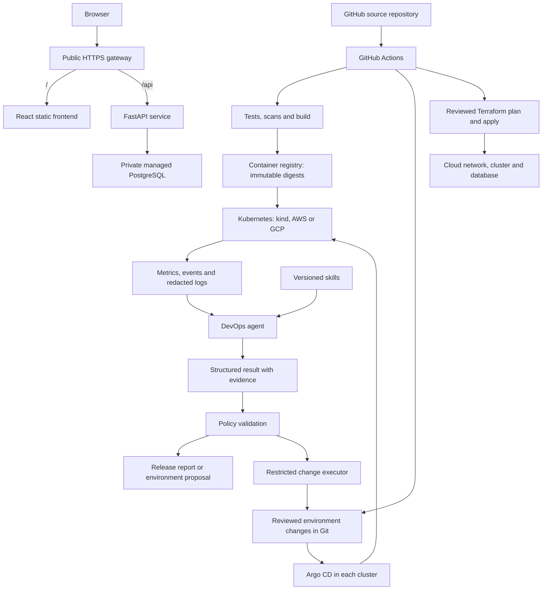

# Idea Board

An implementation plan for a small application and the platform that builds, deploys, and operates it on AWS and GCP. GitHub Actions builds and verifies releases; Argo CD reconciles deployments from Git. A local kind cluster exercises that delivery path before cloud deployment. A DevOps agent uses versioned skills to plan environments and investigate releases.

The original assignment is preserved in [goal.md](goal.md).

**Status:** the backend and web app are implemented, with PostgreSQL, a separate migration job, app-owned tests, and an application CI workflow. Run the full stack with `docker compose up --build --wait` and open `http://localhost:3000`. See the [frontend](apps/frontend/README.md) and [backend](apps/backend/README.md) instructions. Cloud infrastructure, GitOps delivery, and skills below remain planned. Performance numbers are acceptance targets, not benchmark results.

## What we are building

The application stays deliberately small: submit an idea and see the ideas already submitted. Most of the work goes into reproducible infrastructure, safe delivery, useful AI skills, and evidence that the system behaves correctly under load and during failures.

| Area | Planned outcome | How we will verify it |
| --- | --- | --- |
| Application | React frontend, FastAPI backend, PostgreSQL database | API tests and browser tests against the complete stack |
| Local development | All three services start through Docker Compose | A clean checkout can build, migrate, and run the stack |
| Local platform | kind runs Argo CD, the application, and supporting services | A clean bootstrap, Git promotion, drift correction, failed migration, and Git rollback pass locally |
| Containers | Separate frontend and backend images | Both run without root; the released images pass scanning and smoke tests |
| Infrastructure | Terraform provisions Kubernetes, managed PostgreSQL, networking, and access controls | A fresh deployment succeeds on AWS and GCP using the same application configuration contract |
| Delivery | GitHub Actions builds once; reviewed Git changes promote digests through Argo CD | A deployment can be traced to its source commit, configuration commit, image, and migration |
| AI integration | An agent executes environment-planning and release-assessment skills | Recorded evaluations show useful, evidence-backed results and safe handling of bad input |
| Scale | Measured throughput, latency, saturation, recovery, and cost | The same workload runs against both clouds with retained results |
| Handover | Public application URLs and repeatable operating instructions | Both URLs pass the same verification suite; teardown and recovery are rehearsed |

AWS, GCP, GitHub Actions, GitOps with Argo CD, and kind for platform testing are confirmed choices. The remaining stack and operational defaults below are proposed choices. Region, domain, model provider, and spending limits still need to be set before provisioning.

## Architecture



Each cloud runs an independent installation. They share source code, container images, deployment templates, skill definitions, and verification tests. They do not share a live database. Deploying to two clouds demonstrates portability; moving live data between clouds or automatically failing over between them is outside the initial build.

| Component | Choice | Reason |
| --- | --- | --- |
| Frontend | React with TypeScript, built as static assets and served by Nginx | Small runtime and a straightforward container build |
| Backend | FastAPI, SQLAlchemy, psycopg, Alembic | Typed API validation, explicit database access, and versioned migrations |
| Database | PostgreSQL on RDS and Cloud SQL | The same data model and queries work on both providers |
| Orchestration | EKS managed node groups and GKE Standard | Both support the same Kubernetes workload resources and explicit capacity settings |
| Infrastructure | Terraform with separate provider roots and a common output contract | Provider differences stay visible without leaking into application deployment |
| Application packaging | One Helm chart | Replicas, resources, probes, and routing stay consistent across clouds |
| GitOps | One Argo CD installation per cluster, with environment-scoped Applications | Each cluster pulls its approved configuration and corrects drift without CI holding routine deployment access |
| Local Kubernetes | kind with pinned node images and a local registry | Recreates the Kubernetes delivery path cheaply on a laptop and in CI |
| Routing | Gateway API with Envoy Gateway and cert-manager | A common routing model and HTTPS configuration across providers |
| Telemetry | Prometheus, Grafana, structured application logs | Enough evidence to investigate releases and explain scale limits |
| Testing | pytest, frontend tests, Playwright, k6 | Covers logic, browser behavior, and controlled load separately |
| AI execution | A small agent runner with explicit tools and versioned skills | Keeps skill behavior reviewable and separates investigation from privileged execution |

Exact versions will be pinned during implementation. Before adopting the gateway and certificate combination, verify its supported Kubernetes versions and certificate challenge behavior on both clouds. That compatibility check is an early implementation task.

### Request and data flow

1. The browser loads static assets over HTTPS.
2. The frontend calls `/api/ideas` on the same hostname. The gateway routes API requests to the backend, avoiding a separate cross-origin configuration.
3. The backend validates the request and uses a bounded connection pool to reach PostgreSQL over a private network with TLS.
4. PostgreSQL commits the idea before the API returns success.
5. The frontend updates the list only after a successful response. Failed writes retain the draft and display a useful error.

The API contract is below. The ideas and health endpoints are implemented in the first backend step; metrics will be added with telemetry.

| Endpoint | Behavior |
| --- | --- |
| `GET /api/ideas` | Return a JSON array containing all ideas, as required by the case study |
| `GET /api/ideas?limit=50&before_id=42` | Return a bounded page, ordered by descending ID; used by the UI |
| `POST /api/ideas` | Accept `{"content":"My new idea"}`, commit one row with status `201`, and reject duplicate text with `409` |
| `DELETE /api/ideas/{id}` | Delete an idea with status `204`; return `404` when absent |
| `GET /health` | Return `200` when the ideas table is accessible; return `503` when the service cannot serve requests |
| `GET /metrics` | Expose internal metrics; this route is not published through the public gateway |

The page response remains a JSON array. A `Link` response header supplies the next-page URL when another page exists. `limit` defaults to no limit when omitted, accepts values from 1 to 100 when supplied, and is required when `before_id` is used. Invalid pagination returns `422`. The UI starts at 50 items and loads older items on request.

The full-list endpoint cannot have a fixed latency guarantee as the table grows indefinitely. We will measure it separately at increasing dataset sizes and publish the practical limit. The bounded query lets the normal UI continue working without silently changing the required full-list behavior.

The `ideas` table contains `id`, `content`, and `created_at`. Use a PostgreSQL bigint identity primary key, text content, and a timezone-aware timestamp with a database default. Serialize the ID as a decimal string to avoid JavaScript integer precision problems. Return timestamps in UTC. The primary key supports the descending keyset query. A hash exclusion constraint prevents exact duplicate content while supporting the full Unicode text limit.

Trim leading and trailing whitespace, reject blank content, and allow at most 2,000 characters. Limit request bodies to 16 KiB. Render content as text, never as HTML. These limits belong in API validation and tests, not only in the form. Invalid content returns `422`; an oversized body returns `413`; a database outage returns a bounded `503` response without database details.

The application allows anonymous submissions and deletion. The UI confirms deletion before sending the request. Exact duplicate text is rejected after trimming, with case-sensitive comparison. HTTPS, body limits, explicit write-rate limits, database capacity alerts, and a short public demo lifetime are therefore part of the deployment. Rate-limit behavior is tested separately from capacity. Login, editing, voting, and moderation remain outside the scope.

### Runtime behavior

Run one API worker per pod initially. Scale through replicas so connection use and resource consumption remain easy to account for. Set explicit database connect, pool-acquisition, statement, and HTTP request timeouts. Keep the combined database wait and execution budget below the HTTP deadline, and leave time to return a useful error before the gateway times out.

The backend checks database access and required table columns before serving requests; startup fails if that check fails. Migrations run as a separate job before the backend starts. Use the single `/health` endpoint for readiness. Startup and liveness probes check the listening TCP port, so a database outage stops traffic without creating an API restart loop. On termination, stop accepting new work, drain requests, and close the pool within the Kubernetes termination window. Rolling updates use `maxUnavailable: 0` and a small, explicit surge allowance.

Each deployment records the source commit, GitOps configuration commit, image digests, chart source revision, configuration checksum, Argo CD sync revision, and migration revision. Containers run without root, with a read-only root filesystem where supported, dropped Linux capabilities, and explicit resource requests and limits. Pin images and workflow actions to immutable references.

When HPA owns a Deployment's replica count, omit that field from the chart's managed state and configure Argo CD to respect the narrowly scoped replica-field exclusion during comparison and sync. Test that reconciliation does not reset autoscaling. Do not ignore the entire Deployment or use broad drift exclusions.

## AI is implemented through skills

A skill is a versioned operating procedure that the agent can execute. It defines the problem to solve, the evidence to gather, the tools it may use, the result schema, and the conditions that require a person to decide.

The agent can choose which relevant evidence to inspect and reason about what it finds. It cannot invent a tool, grant itself access, or turn text from a log into an instruction. A separate executor proposes bounded changes in Git; Argo CD holds the permissions to reconcile approved Kubernetes resources.

Each skill has:

- A `SKILL.md` describing its purpose, steps, limitations, and examples.
- A machine-readable manifest declaring its identifier, version, input schema, output schema, allowed tools, and execution limits.
- Evaluation cases with expected behavior, including incomplete evidence and hostile input.
- A run record containing the skill version, model version, tool calls, policy decisions, cost, and final result.

The manifest enforces permissions. Instructions in `SKILL.md` explain how to use those permissions; they cannot expand them. Skill changes go through code review and the same evaluation suite as runner changes.

### Skill 1: Plan an environment

**Input:** a goal such as “a low-cost staging environment,” a target cloud, an approved spending cap, and the available deployment profiles.

**Work:** inspect profile definitions, existing capacity measurements, and current provider price estimates. Select a profile and explain its tradeoffs. Return a structured proposal with evidence and unresolved constraints.

**Output:** an approved profile identifier, bounded replica and resource settings, estimated cost with pricing date, and reasons for the choice. The schema does not permit arbitrary Terraform, shell commands, IAM policies, or a new instance type outside the allowlist.

**Execution:** deterministic validation checks the proposal against the environment policy and budget. The executor opens a configuration PR. Infrastructure changes produce a Terraform plan for review and apply; workload changes are reconciled by Argo CD after merge. If pricing is missing or the goal conflicts with the budget, the result must say so rather than fabricate a feasible configuration.

This skill is useful when a high-level request leaves several valid configurations. A direct profile selection remains available when no interpretation is needed.

### Skill 2: Assess a release

**Input:** a deployed release, the previous healthy release, a fixed observation window, and the release policy.

**Work:** compare request rate, errors, latency, readiness, restarts, database waits, and recent warning events. Inspect Argo CD sync status, the observed revision, failed hooks, and bounded, redacted logs when the metrics indicate a problem. Relate the evidence to the deployment changes and distinguish a plausible cause from a confirmed one.

**Output:** `healthy`, `suspect`, or `inconclusive`; a recommendation to keep, investigate, or roll back; evidence references; and an explanation of what changed. Unsupported claims and references to missing evidence fail validation.

**Execution:** the release controller applies the health policy independently. A hard failure can trigger a pre-authorized rollback change in Git, which Argo CD reconciles. A skill recommendation without a matching policy condition requires review. The skill cannot declare a failed health check successful, disable a release gate, or directly patch a workload.

The value is the investigation: for example, showing that latency rose with connection-pool waits after a replica increase, while CPU stayed normal. The evaluation must check whether that explanation is supported; a fluent summary alone is insufficient.

### Runner boundaries

The first tool set is deliberately narrow: read release metadata and Argo CD status, query approved metric templates, read recent namespace-scoped events, read redacted logs, compare approved profiles, and submit a structured proposal. There is no general shell tool or unrestricted Argo CD sync tool. Metric templates take validated parameters; the agent cannot submit arbitrary queries against unrelated environments.

Run the skill process with its own read-only service identity inside the target environment, where it can reach private telemetry. Do not inherit the deployment job's credentials or service account. The executor independently checks the skill result, evidence identifiers, approved release, and current policy before any action. A model-generated result or an uploaded report is never an authorization token.

Start with a limit of 12 tool calls, a 120-second deadline, bounded log output, and a configured token and cost cap per run. Final token limits depend on the selected model. Limit concurrent runs and record cancellations so an event storm cannot create unbounded model spend.

Logs, repository text, and user-supplied goals are untrusted data. Remove credentials and idea content before model calls. Do not provide Terraform state, Kubernetes Secrets, raw environment dumps, or database rows. Store run evidence with restricted access and an explicit retention period.

If the model times out, emits invalid output, exceeds its budget, or has insufficient evidence, the run ends as inconclusive. It does not block a deterministic rollback. Infrastructure planning falls back to manual selection of an approved profile. Model availability must not determine application availability.

## Cloud infrastructure

The two providers need different resources. We will keep those differences inside provider-specific Terraform modules and expose the same outputs to the deployment pipeline.

| Concern | AWS | GCP | Shared behavior |
| --- | --- | --- | --- |
| Kubernetes | EKS and managed node groups | Regional GKE Standard cluster with selected worker zones | Same Helm chart, namespaces, probes, and resource policy |
| PostgreSQL | RDS PostgreSQL | Cloud SQL for PostgreSQL | Compatible major version, schema, TLS, and migration process |
| Network | VPC, subnets, security groups, controlled egress | VPC, subnets, firewall rules, Cloud NAT, private service connectivity | Private workers and database; only the gateway serves public application traffic |
| CI identity | GitHub OIDC to an IAM role | GitHub OIDC through Workload Identity Federation | Short-lived credentials restricted to repository and environment |
| Runtime secrets | Secrets Manager | Secret Manager | Same Kubernetes secret names, populated through External Secrets |
| Image storage | ECR | Artifact Registry | The same image content, verified by digest after copying |
| State | Encrypted S3 backend with supported locking | GCS backend with locking | Separate state per provider, environment, and infrastructure layer |

The Terraform output contract contains cluster identity and location, registry location, database endpoint and name, secret references, and DNS zone information. Environment configuration supplies the namespace and desired hostname. Deployment verification adds the observed gateway address and Argo CD revision after those resources exist; creating the cluster must not depend on reading an Argo-managed gateway. Publish the reviewed DNS configuration after discovering that address, then verify certificates. No output contains a database password. Kubernetes, database, and CI identities have separate roles.

Select the cloud through the environment configuration. A wrapper selects the matching Terraform root and backend, then consumes the common outputs. Do not use one Terraform state and flip a `cloud` variable: that risks replacing an existing environment and mixes credentials. The wrapper must reject a mismatch between configuration, backend, and cloud account or project.

The workflow and chart stay the same when moving between providers. Account identifiers, region, cluster location, domain, profile, and state location change in configuration. Adding a third provider requires another infrastructure adapter and an output-contract test; it should not require application changes.

### Network and access choices

- Put worker nodes and databases on private networks. Managed PostgreSQL has no public endpoint.
- Expose the application through a provider load balancer and the common gateway. Reserve a stable address where needed, create provider-specific DNS records, and issue valid TLS certificates before public verification.
- Allow the backend to reach PostgreSQL on its database port. Deny unrelated pod-to-pod access by default and explicitly allow DNS, telemetry, secret retrieval, and required egress. Verify that the selected CNI actually enforces NetworkPolicy.
- Argo CD runs inside each cluster and pulls approved Git state over outbound HTTPS. Its API is private; routine application promotion does not require a GitHub runner to reach the Kubernetes API.
- Use provider-local, ephemeral runners only for private bootstrap, verification, and controlled recovery operations. GitHub-hosted runners handle code checks, image builds, cloud API calls, and configuration PRs.
- Restrict private runners to protected workflows and approved commits. Fork PRs cannot schedule them. Their instance identity has no broad cluster permissions; jobs obtain narrowly scoped, short-lived credentials after environment approval.
- Give image pulls, application secret reads, migration execution, infrastructure changes, and teardown separate permissions. A runtime pod cannot assume the CI role.

Private bootstrap access is an explicit infrastructure task. Establish remote state and bootstrap identity first, provision the network and cluster using cloud APIs, then create a short-lived runner to install a pinned Argo CD release and its root Application. Runner registration must use short-lived GitHub App credentials stored in the provider secret service, with abandoned-runner cleanup. Normal releases use Git and do not repeat this installation.

Keep cluster provisioning separate from Kubernetes add-on installation. Cloud Terraform roots must not need a reachable Kubernetes endpoint to create the cluster or runner. The bootstrap owns only the minimal Argo CD installation and root Application. Argo CD then owns the declared platform components and workloads; Terraform and CI must not also manage those objects. Upgrade the bootstrap-owned Argo CD installation through its reviewed bootstrap procedure so it has one owner as well.

### Deployment profiles and cost

| Profile | Intended use | Starting shape | Known tradeoff |
| --- | --- | --- | --- |
| `demo` | Public case-study demonstration | One frontend, one API replica, small single-zone database; worker networking spans the zones required by the provider | Workload and database availability are limited; this profile does not prove high availability |
| `scale` | Controlled benchmark window | Two initial API replicas, HPA range 2–6, worker capacity with rollout headroom, same database class on repeat runs | Extra capacity exists only for the booked test window |
| `ha` | Availability and recovery exercises | At least two frontend, gateway, and API replicas across zones; PDBs; multi-zone database availability | Higher fixed cost; zone-failure behavior still needs an actual test |

These are starting configurations. A scale profile must use sustained worker capacity and record the exact machine types; burst credits must not explain a favorable result. Set HPA CPU utilization initially to 60%, then calibrate it using measurements. HPA requires CPU requests and metrics-server. It cannot fix a database bottleneck, and adding pods is allowed only within the database connection budget.

Use this budget before choosing the maximum replica count:

`(maximum API replicas + rollout surge) × workers per pod × pool size + job connections + operator connections + safety reserve <= database max_connections`

For example, six API replicas, one surge pod, one worker, and five connections per worker use up to 35 connections. Jobs, monitoring, operators, and a reserve must fit in the remaining database capacity. Confirm the actual database setting rather than assuming a value from its instance size.

Do not quote a monthly total until region and machine sizes are selected. The estimate must include Kubernetes control planes, workers with Argo CD and telemetry overhead, PostgreSQL, load balancers, NAT, storage, registry, backups, model calls, and load generators. Separate baseline monthly cost from one benchmark run. Record the price source and date.

Before creating billable resources, record an approved total cap, a per-test cap, and a teardown deadline. Cloud budget alerts are notifications, not hard spending stops. Workflow deadlines, maximum replicas, a run lock, cleanup automation, and post-run resource checks enforce the practical bounds.

## Terraform verification

Writing valid HCL is the first check. It does not establish that either cloud can create the resources or that the resulting infrastructure behaves correctly. Both provider implementations must pass the following gates, with separate evidence for AWS and GCP.

| Gate | Work | What a pass establishes |
| --- | --- | --- |
| 1. Static validation | Formatting, provider initialization without a backend, validation, TFLint, and configuration scanning | Syntax, references, provider-schema compatibility, and known configuration mistakes are checked |
| 2. Offline module tests | Native `terraform test` with mocked providers and explicit plan assertions | Module inputs, resource settings, profile choices, and output wiring match the intended contract |
| 3. Real cloud plan | Plan the exact reviewed source against the intended account/project, region, backend, and real provider APIs | Existing dependencies can be read and Terraform can calculate the proposed changes |
| 4. Disposable apply | Apply the reviewed plan in an isolated test environment | The provider accepts the create/update operations and the dependency graph works |
| 5. Behavioral verification | Inspect cloud resources and exercise allowed and denied access, followed by Argo CD bootstrap and an app smoke test | The created system is usable and its important controls actually work |
| 6. Repeat and cleanup | Require a no-change plan; test a representative update; destroy the disposable environment and inspect cloud inventory | Reconciliation is stable, the tested update works, and temporary resources can be removed |

A mocked provider cannot detect a missing cloud permission or a real service quota. A real plan cannot prove create permissions, successful provisioning, or network reachability. A successful apply cannot prove that a pod can reach the database. Keep these results distinct in CI and in the final report.

### Offline checks on infrastructure PRs

Pin a Terraform version that supports provider mocking, along with provider and module versions. Commit root dependency lockfiles and verify them for the CI and supported developer platforms. The intended root checks are:

```bash
terraform fmt -check -recursive infra
terraform -chdir=infra/environments/aws init -backend=false -lockfile=readonly
terraform -chdir=infra/environments/aws validate
terraform -chdir=infra/environments/gcp init -backend=false -lockfile=readonly
terraform -chdir=infra/environments/gcp validate
```

These are planned commands; the Terraform roots do not exist yet. Initialization may download pinned dependencies, but this lane receives no cloud credentials and must not need remote state. Add TFLint with pinned AWS and Google rulesets, configuration scanning, and module tests. Run a matrix covering both providers and the `demo`, `scale`, and `ha` profiles rather than validating only whichever cloud was changed most recently.

Store unit tests under each module's `tests/unit/` and select that directory explicitly with `terraform test -test-directory=tests/unit`. Every offline test must use mocked providers, mocked data sources where needed, and an explicit `command = plan`. Do not let a default apply test or an unmocked lookup enter this lane. Mocked results check our wiring; they are not substitutes for live provider behavior.

Required assertions include:

- Database public access is disabled; encryption, TLS settings, backups, and retention match the selected profile.
- Worker networking, database ingress, cluster access, and controlled egress use the intended subnets and identities.
- IAM and workload-identity trust are restricted to the expected repository, environment, or service account. Unrelated identities are not in the trust policy.
- Node counts, machine allowlists, replica bounds, and database connection budgets respect the profile and cost policy.
- AWS and GCP expose the same typed output contract without secret values. Validate the consuming configuration generator against representative outputs from both adapters.
- Invalid settings fail: overlapping CIDRs, unsupported profile combinations, missing required inputs, and contradictory network or availability options.
- No Kubernetes or Helm provider is needed to plan a cloud foundation. Module provider instances come from the root.

Use Terraform assertions for resource behavior and a small shared schema for the cross-cloud output contract. Avoid snapshotting an entire plan: provider-generated fields make those snapshots noisy and can hide the few settings that matter.

### Credentialed plans and disposable environments

Run cloud plans only from a trusted workflow against a reviewed commit. Terraform configuration and provider plugins execute code; a read-only cloud role is not a reason to give an unreviewed fork credentials. The planning identity gets the required cloud reads and narrowly scoped state and lock access. The apply identity is separate and limited to the test environment. State storage and CI trust are bootstrapped outside that environment's lifecycle.

Before planning, confirm AWS identity or GCP project and impersonated identity, region, enabled APIs, relevant quotas, backend key, and environment labels. A mismatch fails before any apply. Give each disposable run its own state, resource prefix, ownership labels, deadline, and spend cap. Confirm available regional capacity during provisioning; a quota check alone does not reserve capacity.

Save the plan and inspect its JSON with deterministic policy checks. Reject unexpected deletes or replacements, public database exposure, excessive permissions, and settings outside the approved profile. Treat the full plan as sensitive and expose only a sanitized summary for review. Apply the exact approved plan from the same source and dependency locks; changed inputs or expired plans require replanning.

The first complete infrastructure implementation must run through apply, verification, and cleanup in both an AWS sandbox account and a dedicated GCP test project. Later infrastructure changes repeat the affected provider's live tests before that provider's release is accepted. Shared module contracts, generators, or profile changes require both providers. Live `scale` and `ha` behavior must be exercised before making claims about those profiles; an offline assertion is insufficient.

### What we check after apply

| Concern | AWS verification | GCP verification | Behavioral check |
| --- | --- | --- | --- |
| Cluster | EKS active, expected managed node groups and endpoint access settings | GKE running, expected node pools, zones, and endpoint access settings | Authorized bootstrap identity connects; nodes become ready; unauthorized access is denied |
| Network | Subnets, routes, security groups, and egress match the plan | Subnets, routes, firewall rules, NAT, and private service connectivity match the plan | Required outbound traffic works; the database has no public path; pod allow/deny tests pass |
| PostgreSQL | RDS reports the expected version, private settings, encryption, backup retention, and availability mode | Cloud SQL reports matching version, private settings, encryption, backup retention, and availability mode | Backend connects with verified TLS, migrations and writes succeed, and an unrelated pod is denied at the intended network boundary |
| Identity and secrets | OIDC role assumptions and runtime secret access are scoped correctly | Workload Identity Federation and runtime secret access are scoped correctly | Approved identities read their disposable test secret; unrelated identities cannot read it or assume the deployment role |
| Registry | ECR image and pull permissions match the release | Artifact Registry image and pull permissions match the release | A new pod pulls the expected digest using runtime identity without CI credentials |
| Outputs and GitOps | AWS outputs pass the shared schema | GCP outputs pass the same schema | The configuration generator renders valid Applications; Argo CD bootstraps and deploys the same chart and release |
| Public path | Expected load balancer, DNS, and certificate | Expected load balancer, DNS, and certificate | HTTPS create/read/reload succeeds from outside the provider network |

Read actual resource configuration through provider APIs, not only Terraform outputs or the state file. Use disposable canary secrets for negative identity tests. Distinguish a network denial from a failed database password: each test must establish which boundary blocked the request. Backup configuration is checked here; the restore exercise described below establishes recoverability.

### Stable state, updates, and cleanup

After provisioning and the explicit DNS follow-up, a normal refreshed `terraform plan -detailed-exitcode` must return `0`: no proposed changes. Exit `2` means differences remain; exit `1` means an error. Neither is a passing idempotence check. Do not add broad `ignore_changes` rules to hide unexplained drift. Argo-owned resources are outside these Terraform states, so application reconciliation should not generate Terraform changes.

For a module or provider upgrade, create the disposable baseline with the prior supported version, apply the candidate change, and verify its plan and behavior. Check replacements explicitly. A fresh create alone does not prove an existing environment can upgrade safely. Exercise a deliberate, reversible drift case in the sandbox and confirm the plan detects it; reconcile it and require the next plan to be empty.

Live assertions live under the owning AWS or GCP environment root's `tests/live/`; module-specific live cases stay with their module. A small harness runs plan, apply, assertions, repeat-plan, and cleanup in order. Retain state access for recovery if a run fails. Cleanup runs after failed assertions and cancellation, with a separate janitor checking expired run labels if CI disappears entirely. Confirm tagged inventories and known service-specific leftovers are gone, including load balancers, addresses, disks, NAT resources, and non-retained snapshots. An empty state alone is insufficient evidence of cleanup.

Offline checks run on every relevant PR. Credentialed plans run after review; disposable live suites run before accepting initial deployments and relevant infrastructure changes, within the approved budget. Store source and lockfile hashes, provider versions, account/project and region, sanitized plan summary, apply result, live assertions, no-change result, update/drift results, cleanup status, and run cost. A skipped or blocked cloud run remains visible as unverified; kind or mocks cannot turn it green.

## Repository layout

This is the target structure. The frontend, backend, and local Compose stack exist; the remaining components will be added in later steps. App-specific commands and configuration live in the app's README.

```text
apps/
  frontend/
    src/                    # React application
    tests/                  # Frontend unit, component and browser E2E tests
  backend/
    src/                    # FastAPI application
    migrations/             # Alembic history
    tests/                  # API unit, PostgreSQL integration and k6 workloads
  agent/
    src/                    # Skill runner, tool adapters and validation
    tests/                  # Runner and tool-adapter unit and integration tests
deploy/
  chart/                    # Shared Helm chart, with its own tests/ directory
  platform/                 # Add-on definitions, with component-specific tests beside them
  environments/             # Non-secret cloud and environment settings
gitops/
  projects/                 # Argo CD repository, namespace and resource restrictions
  environments/kind/        # Local root and child Application definitions
  environments/aws/         # Independently promoted AWS Applications
  environments/gcp/         # Independently promoted GCP Applications
local/
  kind/                     # Cluster, registry, Git fixture and bootstrap configuration
  fixtures/                 # Local secret backend, certificates and database settings
infra/
  bootstrap/                # State storage and initial CI trust
  modules/aws/              # AWS-specific modules; each module owns its tests/
  modules/gcp/              # GCP-specific modules; each module owns its tests/
  contracts/                # Shared output schema and its tests/
  environments/aws/         # AWS root and tests/live/ assertions
  environments/gcp/         # GCP root and tests/live/ assertions
platform/
  policy/                   # Allowed profiles and execution rules, with their own tests/
  release/                  # Trusted observation and Git rollback logic, with its own tests/
skills/
  plan-environment/          # SKILL.md, manifest, schemas and local tests/ evaluations
  assess-release/            # SKILL.md, manifest, schemas and local tests/ evaluations
tests/
  platform/
    gitops/                 # Cross-component bootstrap, sync, drift and rollback tests
    load/                   # Environment orchestration and infrastructure measurements
    resilience/             # Cross-component failure and recovery exercises
docs/
  architecture/             # Decisions and provider contracts
  runbooks/                 # Deployment, rollback, recovery and teardown
  results/                  # Sanitized benchmark and verification reports
.github/workflows/          # CI, delivery, skill evaluation and cleanup
Makefile                    # Thin wrappers for repeatable local and test commands
docker-compose.yml
.env.example
```

Tests follow the code they verify. Frontend browser journeys belong in `apps/frontend/tests/` and run against Compose, kind, or cloud URLs through configuration. API integration tests and k6 API workloads belong in `apps/backend/tests/`; agent tests belong in `apps/agent/tests/`. Chart tests, Terraform module tests, policy and release-logic tests, and skill evaluations stay with those components. `tests/platform/` holds only scenarios and orchestration that exercise several components together; it invokes app-owned tests instead of duplicating them.

### Patterns taken from existing infrastructure repositories

The local Terraform and Helm repositories provide useful structural references:

- Separate reusable provider modules from environment instantiation. Declare provider requirements in modules and configure credentials and provider instances at the root. Pass discovered outputs instead of copying environment identifiers.
- Keep infrastructure-derived settings generated from Terraform outputs. Define values precedence explicitly: chart defaults, profile, environment, generated infrastructure values, then a release override limited to image and migration references. Reject hand-edited infrastructure-owned fields and render the final configuration in CI.
- Keep Argo CD Applications separate from AppProjects. Render the effective destination and resource permissions and verify the intended namespace is allowed before sync.
- Make the canonical rendered manifest a review artifact. Assert the expected Deployments, Services, secret references, and routes exist; an empty render must fail even if the renderer exits successfully.
- Place Helm unit tests inside each chart and Terraform assertions inside each module. Use fast local checks before a live cluster test.
- Update release values in Git and let Argo CD auto-sync. Observe the requested revision and workload health separately from the Git write.

Implement small equivalents for this project. Existing organization-specific module packages, account mappings, registries, and generated configuration are not dependencies of the public build. Keep the explicit digest pins, separate migration job, restricted project permissions, and narrow drift exclusions described here when adapting the patterns.

## GitOps ownership and promotion

Git is the desired state for Kubernetes resources. Use this repository initially, with protected paths for `gitops/`, deployment templates, policies, and workflows. A separate configuration repository can be introduced later if access requirements justify it.

| Tool | Owns | Does not own |
| --- | --- | --- |
| Terraform | Cloud networks, clusters, managed databases, identities, registries, and state | Application Deployments or Argo-managed add-ons |
| Bootstrap procedure | Initial Argo CD installation, project restrictions, and root Application registration | Routine application releases |
| GitHub Actions | Checks, image builds, provenance, infrastructure plans, promotion PRs, and release verification | Direct `helm upgrade` or `kubectl apply` for routine releases |
| Helm | Rendering application and platform resources from pinned templates and values | Maintaining a second deployment history outside Argo CD |
| Argo CD | Reconciling approved Kubernetes resources, sync status, health, and drift correction | Building images, provisioning managed databases, or deciding business health from metrics |
| Release controller | Observation windows, health policy, promotion status, and bounded Git rollback requests | Rendering arbitrary model-generated commands |
| Skills | Evidence gathering, environment proposals, and release explanations | Unreviewed Git writes or direct cluster mutation |

Argo CD renders Helm charts; Helm release history is not the rollback source of truth. Each environment's Application pins the chart source to an exact Git commit and specifies immutable image digests in its environment values. Updating a chart directory on the default branch must not silently promote that chart to every cloud. A root Application watches only its environment's configuration path; its child Application definitions hold those explicit source revisions and values.

The release controller is trusted workflow logic with short-lived, read-only verification jobs, rather than another resident rollout operator. Private verification runners collect Argo CD and telemetry evidence; a separate job holds the narrowly scoped Git write identity. Keep health-policy evaluation and revision checks in `platform/release/` with their own tests. kind exercises that same logic against the local Git fixture; hosted branch protection and real cloud identity are verified separately.

Use separate Argo CD projects for platform resources and application workloads. Restrict source repositories, destination clusters, namespaces, and permitted resource kinds. Application projects cannot create cluster roles, change Argo CD settings, or target another namespace. Keep administrative access private and repository access read-only. Argo CD never needs the Git write credential used by the promotion executor.

Enable automatic sync and self-healing for approved environment changes. Review rendered deletions in PRs and fail validation on unexpected pruning. Require explicit confirmation for deletion-sensitive resources and prevent automated empty-application deletion. Keep local PostgreSQL data volumes protected from ordinary pruning; cloud databases remain outside Argo CD entirely.

When Git is unavailable, the existing application keeps serving, but new syncs stop. Alert on stale reconciliation and retain the last observed revision. When the registry is unavailable, existing pods continue running where possible; unavailable replacement images are a release failure. Neither outage is a reason to invent a new desired state.

### Ordering and migrations

Bootstrap platform controllers and CRDs first, then wait for their actual readiness before registering the application. Across separate Applications, sync waves alone do not guarantee dependency ordering. The bootstrap and promotion checks must wait for the required Application revision and health explicitly.

Within the application, use this order:

| Sync wave | Resources or action | Required condition before proceeding |
| --- | --- | --- |
| `-20` | Service accounts, configuration, and ExternalSecret references | Required secrets are synchronized for the requested configuration |
| `-10` | Alembic migration as a `Sync` hook Job | Job completes successfully under a database advisory lock |
| `0` | Frontend and API Deployments, Services, HPA, and disruption policies | Expected workloads become ready with the requested digests |
| `10` | Application HTTPRoutes | Routing resources are accepted by the gateway |
| Post-sync | Bounded create-and-read smoke Job | The deployed service can persist and retrieve a new idea |

Define and test ExternalSecret health checks, including freshness after a configuration change. Do not use a `PreSync` migration that depends on secrets being created later in the same sync. Retain failed hook logs and capture successful hook evidence before cleanup. Migrations must be safe to rerun after a retry or self-heal; database locking protects against other migration clients as well.

Track the migrator image and schema revision separately from runtime image digests. During a rollback, retain the current compatible schema and migrator reference instead of running an older migration history or requesting a downgrade. The migration job verifies the desired schema and is a no-op when it is already applied.

## Delivery pipeline

### Application CI

[The CI workflow](.github/workflows/ci.yml) runs on pull requests, pushes to `master`, and manual dispatch. It has three independent jobs:

| Job | Checks |
| --- | --- |
| Backend | Ruff lint and formatting, mypy, unit tests, and PostgreSQL integration tests |
| Frontend | Formatting, TypeScript, and component tests |
| Containers and full stack | Build both images, start Compose, exercise the API through Nginx, and rerun the standalone migration |

The Compose job loads the images it just built and starts with `--no-build`; the migration service uses the same backend image. Failed stack checks retain Compose status and logs for seven days. Jobs have explicit deadlines, use read-only repository permissions, and pin actions to commit SHAs. They do not publish images or deploy infrastructure.

The Python and Node test jobs cache downloaded packages using the app lockfiles. Container builds use separate GitHub Actions cache scopes for the backend and frontend, with intermediate layers exported through BuildKit's `mode=max`. A source change reuses the dependency-install layer. Backend documentation changes leave dependency installation cached; frontend tests are excluded from the production build context.

The Dockerfiles also mount uv and npm download caches for local incremental builds. These mounted directories are not exported by the GitHub Actions layer cache: on a fresh runner, a changed lockfile still needs to download packages, while an unchanged dependency layer is restored intact. Cache availability affects build time, not correctness. Runtime images contain the installed backend or static frontend assets; package managers and test dependencies stay in build stages.

The remaining pipeline sections describe later platform work.

### Pull requests

Run backend linting, type checks, unit and PostgreSQL integration tests; frontend linting, type checks, component tests, and a production build; Terraform formatting, validation, and policy checks; Helm and Argo CD manifest validation; skill evaluations; and a Compose-backed browser smoke test. Scan dependencies, repository secrets, container images, and infrastructure configuration.

Relevant application, chart, platform, skill-runner, and GitOps changes also run the kind integration suite. Documentation-only changes skip cluster startup. Configuration-only promotion PRs validate and test the referenced release without rebuilding or publishing it. Separate path filters and workflow triggers prevent promotion commits from producing an endless image-build and promotion loop.

Use pinned tool versions, committed lockfiles, least-privilege workflow permissions, and pinned third-party actions. Do not run PR code in a job holding cloud or model credentials. Fork PRs receive read-only checks and recorded skill evaluations with fixtures; live model evaluations are a separate trusted job. A PR comment is never sufficient authorization to deploy.

### Infrastructure changes

Provision or change cloud resources through a reviewed Terraform plan with short-lived OIDC credentials. Confirm account, region, state backend, quotas, profile, and budget before apply. Saved plans are short-lived, access restricted, and treated as sensitive; changed inputs require a new plan. This workflow runs when infrastructure changes, not for every application release.

Require the Terraform verification gates above: offline module assertions, a real provider plan, disposable apply and behavioral checks, no-change planning, and verified cleanup. Keep independent AWS and GCP statuses; a successful kind run is a separate gate.

Bootstrap Argo CD only after private access is available. Wait for the platform Applications, CRDs, gateway, secret backend, metrics, and namespace prerequisites before admitting the first application sync. Record the non-secret provider outputs in environment configuration through a reviewed change.

### Build and promote

1. Merge reviewed code to the protected default branch.
2. Build frontend, backend, and agent images once when their source changes. Produce an SBOM and provenance, scan the images, and record their digests. An isolated publish job receives only validated build artifacts and registry access.
3. Copy the tested images to the target registries and verify the expected digests. Do not rebuild an image for the second cloud. Verify node architecture compatibility as part of the release record.
4. Select an approved environment profile directly or request a proposal from the environment-planning skill. Apply any required infrastructure change through its separate reviewed workflow first.
5. Open an AWS promotion PR that updates only the intended environment's image digests, pinned chart source, compatible migration reference, and approved configuration. Show the rendered resource diff and deletion checks.
6. Run configuration checks and the kind GitOps suite against those exact artifacts. Merge through protected-branch review and required checks using a narrowly scoped GitHub App identity.
7. Argo CD detects the Git change and performs the ordered sync. The release observer verifies the exact requested configuration revision and workload digests, not merely an old `Healthy` status.
8. Run public HTTPS smoke tests and the ten-minute release observation window. Invoke the release-assessment skill against that release's evidence. Argo CD `Synced` and `Healthy` are necessary, but do not prove that latency and error targets passed.
9. Mark the AWS release accepted only when the deterministic gates pass. Save the report and previous healthy configuration. On failure, execute the bounded Git rollback path below.
10. Promote the same artifacts through a separate GCP configuration PR only after AWS is accepted. Perform the same sync, verification, and observation there.

The kind promotion check uses the exact candidate chart source and image content with explicit local database, secret-store, hostname, and registry overrides. It also validates the separately rendered cloud configuration. Obtain private release images as verified OCI artifacts through a trusted fetch stage before running candidate code; the cluster test job receives no cloud identity. Rehosting an image in the local registry must preserve its digest. Passing local adapter tests does not establish that the cloud-specific values work live.

Serialize changes per cloud and environment, including the complete observation or rollback window. Do not merge a second promotion while the prior release is unresolved; enforce this in required checks and recheck the expected current revision immediately before merge. This prevents a known bad release from being promoted twice, but does not make deployments across the two clouds atomic. Show each cloud's status separately.

Do not use `pull_request_target` to check out and execute PR changes with privileged credentials. Preview environments are an optional later feature; they are not needed for the first delivery and will not introduce an early privileged comment-trigger path.

### Release gates and rollback

Start with the following policy, then revise it only through a reviewed change backed by measurements:

- Allow up to two minutes for Argo CD to detect an approved commit, then a bounded sync window: three minutes for prerequisites, five minutes for migration, five minutes for workload readiness, and two minutes for smoke checks. Enforce these stage deadlines in the release observer and Job settings; do not assume Argo CD supplies them automatically. Probe failures, image-pull failures, migration failures, and unavailable required telemetry fail the release.
- Collect a ten-minute post-deployment window. When a prior healthy release exists, compare with its ten-minute pre-deployment baseline at a comparable request mix.
- Generate five synthetic paged reads per second during quiet periods and run a separate create-and-read smoke check. Evaluate distinct, non-overlapping one-minute windows and require at least 100 requests before making a latency or error-rate decision.
- Fail on unexpected `5xx` responses above 1% for three consecutive qualifying windows, or paged-read p95 above 500 ms for three such windows. A complete public outage fails immediately after three consecutive synthetic failures at ten-second intervals.
- Compare error and latency changes with the baseline for investigation. Relative changes without an absolute failure are reported for review; they do not create a hidden second rollback policy.
- Exclude expected `4xx` validation responses from server-error calculations, but report all status categories. Missing traffic or missing telemetry produces an inconclusive result, never a healthy one.

The controller, not the model, evaluates these conditions. A skill can recommend investigation even when absolute gates pass. The first release uses absolute thresholds and is explicitly marked as having no previous baseline.

Rollback creates a new Git commit restoring the previous healthy runtime digests and compatible environment values, while retaining the current schema and migrator reference. Argo CD reconciles that commit. Do not use `helm rollback`, a one-off Deployment patch, or an Argo CD history rollback as the ordinary recovery path: those actions leave Git pointing at the failed release and self-healing can reapply it. Preserve history; never reset the branch or amend an existing release commit.

The executor opens a rollback PR, verifies that the environment still points at the failed release, and changes only the permitted release fields. A pre-authorized automation identity may merge that narrowly validated PR after required checks. Confirm that repository rules support this path before claiming automatic rollback; otherwise the report must request an operator merge. Test the actual GitHub permissions and merge rules as well as the local simulation.

Define a reviewed fast path for restoring previously validated artifacts: check the exact prior release record, digest provenance, schema compatibility, allowed field diff, and current environment revision without bootstrapping a new kind cluster. Required check contexts must still report a result. A changed chart, new artifact, or broader configuration change takes the full validation path. Measure this path before treating the five-minute recovery target as achievable.

Do not automatically reverse database migrations. Use expand-and-contract migrations: add compatible schema first, deploy code, and remove old schema only after the rollback window closes. A destructive migration needs a separate reviewed maintenance and recovery procedure.

Measure rollback time from the health decision through Git merge, Argo CD detection, and restored public health. Target five minutes for that path; if it is exceeded, stop promotion, retain evidence, and escalate to the operator. Do not let the agent repeatedly alternate between releases. Allow one automatic rollback per deployment. A failed first release has no previous healthy target: stop it and request operator recovery instead of claiming a rollback succeeded.

## Testing strategy

Tests need to cover correctness and platform behavior, not only whether containers start.

| Layer | Test owner | Required cases | When it runs |
| --- | --- | --- | --- |
| API unit tests | `apps/backend/tests/` | Content validation, response serialization, pagination parameters, error mapping | Every relevant PR |
| Database integration | `apps/backend/tests/` | Migration from empty and prior schema, persistence, ordering, pagination boundaries, concurrent writes, pool exhaustion | Every relevant PR against real PostgreSQL |
| Frontend | `apps/frontend/tests/` | Loading, empty list, validation, failed submission, retry behavior, safe rendering of hostile content | Every relevant PR |
| Browser E2E | `apps/frontend/tests/` | Create and read an idea, reload persistence, multiple pages, two concurrent users, API unavailable, database unavailable | Compose on app PRs; kind on platform changes; core smoke suite on each cloud |
| Agent runtime | `apps/agent/tests/` | Tool authorization, schema validation, evidence references, deadlines, cancellation, provider errors | Every runner or adapter PR |
| Chart rendering | Each chart's `tests/` | Image digests, values precedence, resource requests, probes, HPA ownership, secret and migration waves, non-empty output | Every chart or configuration PR |
| Terraform modules | Each module's `tests/unit/` and module-specific live cases | Input validation, required outputs, private database settings, identity scope, incompatible configurations | Mocked plan assertions on PRs; live cases after review |
| Cloud foundation | Each provider root's `tests/live/`; shared schema tests in `infra/contracts/` | Real plan/apply, cloud API assertions, allowed/denied access, app bootstrap, no-change plan, upgrade/drift, verified destroy | Both providers initially; affected providers before infrastructure acceptance |
| GitOps and delivery | `tests/platform/gitops/` | Clean bootstrap, sync ordering, drift, failed migration, stale revision, overlapping promotion, failed health gate, Git rollback | kind on relevant PRs; cloud and GitHub-specific checks before handover |
| Release policy | `platform/release/tests/` | Window calculations, missing samples, stale evidence, target revision checks, allowed rollback fields, single-rollback limit | Every release-logic or policy PR |
| Skills and policy | Each skill's and policy component's `tests/` | Supported diagnosis, prompt injection, malformed output, missing evidence, denied actions, budget exhaustion | Fixtures on relevant PRs; live evaluation before skill promotion |
| Security | Owning app or component; platform checks in `tests/platform/` | Injection, stored XSS, oversized bodies, rate limits, secret leakage, network denial, project restrictions, unauthorized workflows | Relevant PRs and before public release |
| Load and resilience | API workloads in `apps/backend/tests/`; orchestration in `tests/platform/` | Load profiles below, pod loss, worker drain, database interruption, recovery | Short kind checks on PRs; full runs explicitly within the cloud budget |

Use unique run identifiers in test ideas and keep fixture cleanup scoped to those identifiers in isolated environments. Never clear a shared database as test setup. Browser writes do not retry automatically: a timed-out POST may already have committed, and the initial API does not promise idempotent submission.

Skill evaluations include labeled release incidents: bad database credentials, migration incompatibility, connection exhaustion, CPU saturation, a healthy traffic increase, and absent telemetry. Check the diagnosis against evidence and require every write request to remain within policy. Compare useful findings and operator review time with a deterministic metrics-only report; record misses as well as successful explanations.

## Local platform testing with kind

Compose is the quick application development path and remains a case-study deliverable. kind is the required Kubernetes and GitOps integration environment. A passing Compose test does not establish that Argo CD, chart rendering, sync hooks, RBAC, or network policy work.

### What runs locally

| Component | Local setup | What stays shared with cloud |
| --- | --- | --- |
| Kubernetes | Pinned kind node image; one control-plane node and two workers for scheduling and disruption tests | Supported Kubernetes API versions, namespaces, workload resources, and probes |
| Argo CD | Same pinned release; reduced controller resources, private local access | Projects, root and child Applications, sync rules, and revision checks |
| Images | Local OCI registry reachable by the host and kind nodes | Pull-by-digest behavior; no bypass through images preloaded only on one node |
| Git | Isolated test remote holding the exact candidate source and configuration | Pull-based reconciliation and forward commits for promotion and rollback |
| PostgreSQL | A single PostgreSQL StatefulSet and PVC, in a separate local database Application | PostgreSQL major version, schema, migration job, connection limits, and API behavior |
| Routing and TLS | Envoy Gateway, host port mappings, cert-manager, and a local CA trusted by the test clients | HTTPRoutes, same-origin browser calls, and certificate resources |
| Secrets | External Secrets with its Kubernetes provider reading disposable fixture secrets from a restricted namespace | ExternalSecret resources, target secret names, ordering, and readiness checks |
| Metrics | metrics-server, Prometheus, kube-state-metrics, and Grafana with local retention and resource settings | Dashboards, queries, alerts, and release evidence contract |
| Network policy | A pinned policy-enforcing CNI; disable kind's default CNI and test the chosen replacement | Explicit allow and deny rules verified by actual traffic |
| Skills | Agent Job with its read-only identity and recorded model responses by default, added during the skill milestone | Runner, skill definitions, tool adapters, schemas, and policy decisions |

The local database and secret fixture Applications are enabled only by the kind configuration. Cloud configurations must reject an in-cluster database or fixture secret backend. Fake secret values never reuse cloud credentials. Live model calls are opt-in for local development and excluded from untrusted PR jobs. Every new platform component, including the agent, must join this local environment and pass its tests before cloud promotion; the initial GitOps bootstrap does not wait for AI implementation.

Use one node when a developer needs a smaller functional profile; mark disruption and topology tests as unavailable in that profile. The complete platform suite uses two workers, modest but explicit resource allocations, and records the host's Docker CPU and memory settings. Establish the minimum tested laptop and CI runner sizes during the first bootstrap milestone; insufficient resources must produce a clear setup failure.

CI uses the same CPU architecture as the cloud release. A developer on an ARM64 laptop can use native images for workflow testing, with the architecture recorded. Passing that run does not replace verifying the cloud release images on their actual architecture.

### Bootstrap and verification

1. Check Docker resources and pinned versions of kind, kubectl, Helm, Argo CD CLI, and the test tools. Verify that the chosen Kubernetes, CNI, gateway, and Argo CD versions work together.
2. Create a uniquely named cluster and its isolated Docker network attachments. Start a local registry and read-only Git service, and verify reachability from both the host and cluster. The test driver updates the fixture remote; Argo CD has read-only access.
3. Build candidate images, push them to the registry, record their digests, and create the local environment commit. The fixture remote contains the candidate PR snapshot, not an unrelated default-branch version.
4. Install the policy-enforcing CNI and storage prerequisites. Bootstrap pinned Argo CD, scoped projects, and platform Applications through the same ownership boundaries used in cloud.
5. Wait for controllers, CRDs, the local database, local secret store, gateway, certificates, and telemetry to be ready. Register the application and let Argo CD perform its normal secret, migration, workload, and smoke-check sequence.
6. Verify the expected source and configuration revisions, actual container image digests, required resource inventory, and public-path behavior through the mapped gateway. A zero exit code or a stale `Healthy` status is insufficient.
7. Run frontend-owned browser tests, backend-owned API checks and a short load workload, agent-owned integration tests, and the cross-component GitOps scenarios.
8. Save evidence on success or failure, then delete the uniquely named cluster, test remote, registry, fixture secrets, and run-specific volumes. Cleanup must run after cancellation as well as test failure.

Fresh bootstrap and a second bootstrap against the existing cluster must both pass. The second run must not reset the database or replace healthy workloads unnecessarily. CI always starts from an empty cluster to catch accidental reliance on a developer's cache or previous objects.

### Required platform scenarios

| Scenario | Expected result |
| --- | --- |
| Promote release A to B with a configuration commit | Argo CD observes B's exact revision, completes the migration and rollout, and serves B's expected digests |
| Change a managed Deployment field out of band | Self-healing restores the Git value within two minutes under the test reconciliation settings |
| Scale through HPA while Argo CD reconciles | Autoscaling changes are preserved; other Deployment drift is corrected |
| Fail secret synchronization | Migration and workload promotion wait, the release deadline fails, and the old healthy workload keeps serving where available |
| Fail a migration | The new workloads do not roll out; failure evidence identifies the hook and the previous release remains available |
| Deploy a broken image, readiness probe, or route | Sync or smoke checks fail; the release cannot be accepted |
| Revert runtime values through a new Git commit | Previous compatible images return, the current schema remains, and later self-healing keeps that restored state |
| Return an old revision with `Healthy` status | The observer rejects it as evidence for the requested release |
| Render an empty app or target a forbidden namespace | Validation or project restrictions reject the change before it can be accepted |
| Request destructive pruning or remove the local database Application | Deletion protection requires the explicit teardown path and preserves its data by default |
| Interrupt Git, the registry, Argo CD, or the model adapter separately | The existing app behaves as documented; reconciliation and skill status expose the failure and recover when the dependency returns |
| Inject an instruction into logs or attempt a denied tool call | The skill treats it as data, its permissions remain unchanged, and the denied request is recorded |
| Lose one API pod or drain one worker during modest load | Readiness, disruption rules, scheduling, and graceful shutdown behave as expected; acknowledged writes remain present |

Keep local failure cases bounded and deterministic. Capture Argo CD Application and operation status, rendered resources, Kubernetes events, migration logs, pod logs, metric windows, k6 output, and browser traces on failure. Redact secrets before retaining artifacts.

kind verifies controller integration and failure handling. Managed PostgreSQL failover and backups, cloud IAM and OIDC, provider load balancers, public certificate issuance, real multi-zone behavior, storage performance, and cloud cost require separate AWS and GCP checks. A few kind nodes share one host and do not represent independent machines or availability zones. Local load runs check the harness and detect regressions; the cloud runs below establish capacity.

## Scale-test plan

The aim is to find the capacity limit and explain it. A large request count without latency, correctness, and saturation evidence does not demonstrate scale.

### Test conditions

Run load generators outside the application cluster so their CPU and network use cannot consume worker capacity. For capacity comparisons, place a generator in each target cloud's region and call the public HTTPS endpoint. Also run a separate external-region smoke test for the user-facing path. Record the source location, DNS result, TLS behavior, and network latency.

Use the same image digests, PostgreSQL major version, database shape as closely as providers allow, resource limits, fixture sizes, and backend-owned k6 script on both clouds. Record unavoidable differences rather than calling the environments identical. Hold new Git promotions for the test environment while keeping Argo CD reconciliation enabled, and take a database snapshot before destructive recovery exercises. Apply the scale profile and temporary benchmark rate-limit settings through Git before the run; restore the agreed profile through Git afterward.

Seed 10,000 ideas for the standard workload, using a documented content-size distribution: 80% around 100 characters, 15% around 500, and 5% at the 2,000-character limit, including Unicode. Use a fixed seed. Repeat the dataset-growth test with 100,000 ideas. Count actual encoded response bytes; character count is not a byte estimate.

The main workload is 90% paged reads of 50 items and 10% valid writes, with both first-page and older-page queries. Measure full-list reads in a separate scenario so the growing response does not obscure ordinary UI performance. Restore the same seed before comparable runs, then report the row count and table size as writes accumulate. Do not describe a mixed read/write run as a fixed dataset.

Use one measured HTTP request per k6 iteration so the stated arrival rate matches requests per second. Keep fixture setup, correctness reconciliation, and cleanup outside the measured window. Set a reviewed, expiring rate-limit allowance for the benchmark source so application capacity can be measured; test the normal public limits separately and restore them afterward. A run dominated by `429` responses has measured the limiter, not application capacity.

Use k6 arrival-rate executors so requests continue to arrive at the configured rate when the service slows down. Report configured arrival rate, achieved requests, dropped iterations, active virtual users, and client errors. Size virtual-user capacity from measured response time with headroom; a generator that drops iterations has not proved the target rate.

| Scenario | Load and duration | What it answers |
| --- | --- | --- |
| Harness check | 1 request/s for 2 minutes | Do fixtures, TLS, response checks, metrics, and cleanup work? |
| Baseline | 10 requests/s for 10 minutes after a 5-minute warmup | What does healthy latency and resource use look like? |
| Step load | 25, 50, and 100 requests/s, 10 minutes at each level | Where does latency or saturation start to change? |
| Initial target | 100 requests/s for 30 minutes | Can the proposed scale profile sustain the stated target? |
| Spike | 10 to 200 requests/s within 10 seconds; hold 5 minutes, then return to 10 for 10 minutes | How does the service reject excess work and recover? |
| Soak | 50 requests/s for 2 hours, subject to the approved cost window | Are memory, connections, latency, or storage growing unexpectedly? |
| Capacity search | Add 25 requests/s every 5 minutes above 100, capped at 300 requests/s | What is the first repeatable bottleneck within the spending limit? |
| Dataset growth | Paged reads at 100 requests/s on both fixtures; full-list reads separately at 1 and 5 requests/s | Does bounded retrieval remain stable, and what does the required full-list endpoint cost? |
| Failure under load | 50 requests/s while deleting one API pod, draining one worker, then testing a database interruption separately | What fails, how much traffic is affected, and how quickly does it recover? |

Keep fault experiments separate and return to a healthy baseline between them. Worker drain requires spare capacity and is distinct from abruptly losing a zone. Database failover is exercised only on the HA profile; restarting a single-zone database is an outage test, not an HA demonstration.

### Initial acceptance targets

For the 100 requests/s, 90/10 workload against the 10,000-row starting dataset:

- Paged-read p95 at or below 300 ms and p99 at or below 750 ms.
- Write p95 at or below 500 ms and p99 at or below 1 second.
- Unexpected server errors below 0.5%, with zero response-validation failures and no dropped load-generator iterations.
- Every acknowledged write is present exactly once when checked against unique submission markers. Timed-out writes are reconciled separately because commit status may be unknown to the client.
- No OOM kills, uncontrolled restarts, pool leaks, or sustained database connection use above 80% of the configured allowance.
- No sustained CPU saturation above 85% at the service's maximum allowed replicas. Report HPA changes, pending pods, node headroom, database CPU, locks, query latency, I/O, and pool-acquisition waits.

These targets apply to the scale profile and public request path from the documented generator location. They do not apply to an unbounded full-list response or imply production capacity. A test that misses a target still produces a useful result: identify the limiting resource, make one justified change, and rerun the same workload.

For the spike, report error rates and latency during overload, then require latency and unexpected errors to return to baseline within five minutes after load returns to 10 requests/s. For single API pod loss on the scale profile, require no acknowledged write loss and restored ready replica count within two minutes. Measure worker and database recovery separately; report their observed times until the HA design has been tested well enough to set a defensible target.

Stop a test if unexpected errors exceed 5% for two consecutive minutes, the database exceeds 90% of its connection allowance, available storage falls below 20%, spend reaches the run cap, or the operator cancels. These are benchmark protection limits, separate from release gates. Record the stop condition and run cleanup even after failure.

### Evidence and repeatability

For each run, retain:

- Commit, image digests, skill versions if used, UTC run times, provider, region, profile, and exact infrastructure sizes.
- GitOps configuration commit, Argo CD observed revision and sync status, HPA changes, and any reconciliation events during the run.
- Workload file, fixture seed, starting and ending row counts, arrival rate, and rate-limit settings.
- k6 summary and raw time series, response-check failures, latency percentiles, and achieved throughput.
- Aligned application, pod, node, database, gateway, and pool metrics, plus relevant redacted events and logs.
- Acknowledged-write reconciliation, cleanup results, resource changes, and estimated run cost.
- A short finding: limiting resource, evidence, proposed change, and result of the repeat run.

Repeat the baseline and initial target three times on each cloud, restoring the same starting dataset between runs. Report each run and the spread; do not average percentiles or discard the worst run. Run the long soak and fault exercises at least once per cloud. A materially changed configuration needs a new baseline before its results are compared.

## Local development and deployment interfaces

The application-only Compose command below works now. The kind and cloud interfaces remain planned.

The application-only path requires Git, Docker, and Docker Compose. Host installations of Node and Python are optional when using the containers.

```bash
docker compose up --build --wait
```

Compose orders PostgreSQL readiness, a one-shot migration service, backend startup, and frontend startup. A failed migration blocks the backend. The frontend is available at `http://localhost:3000`, with `/api` proxied to the backend. PostgreSQL is also exposed on loopback port `55432` for host development and backend integration tests. The backend API is available directly on loopback port `8000`. The database volume survives `docker compose down`; adding `--volumes` deletes local data.

Compose contains local development credentials. Host backend settings are documented in `apps/backend/.env.example`; the frontend uses same-origin API requests and needs no environment file. Production secret wiring remains a platform step. Production secrets never go in development files or in git.

The full platform path also requires Make and the pinned kind, kubectl, Helm, and Argo CD CLI versions. A thin Makefile will wrap the checked-in bootstrap and test scripts:

```bash
make kind-up
make kind-test
make kind-down
```

`kind-up` must provision the local registry and Git fixture, cluster, Argo CD, platform dependencies, and application. `kind-test` invokes the app-owned tests and shared platform scenarios against that cluster. `kind-down` removes only this project's explicitly named resources. The scripts must reject an unexpected Kubernetes context and save failure evidence before cleanup. Document local application and Argo CD access, CA trust, port mappings, tested resource minimums, and reset behavior beside these commands.

Cloud setup instructions will cover, in order:

1. Create the AWS account roles and GCP project, enable required APIs, confirm quotas, and choose regions with the required managed PostgreSQL versions.
2. Register the domain or delegate a subdomain and choose distinct AWS and GCP hostnames.
3. Set up remote state and GitHub OIDC trust using an authorized operator identity. Document this one-time bootstrap separately from normal deployment.
4. Configure protected GitHub environments, approval rules, cloud identifiers, profile, cost limits, and secret references.
5. Provision foundation resources, run output-contract and access checks, bootstrap Argo CD through a private runner, and wait for the platform Applications to become ready.
6. Merge an AWS promotion PR, observe the exact Argo CD revision, and verify the release. Promote the same artifacts to GCP through its own configuration PR after AWS passes.
7. Verify public HTTPS, submit and reload an idea, restart the API, confirm persistence, and retain both working URLs.
8. Run the approved scale schedule, collect evidence, return to the agreed demo capacity, and check for unused resources.

The final README will replace these interface descriptions with tested commands and actual configuration names. It must be verified from a clean checkout before handover.

## Implementation sequence

Each milestone has an exit condition. Avoid building the agent before there is a working deployment and real evidence for it to inspect.

| Milestone | Work | Exit condition |
| --- | --- | --- |
| 1. Contracts and decisions | Confirm API behavior, GitOps ownership, profiles, cloud settings, domain, model data policy, budgets, and success criteria | Reviewed decisions; no unresolved prerequisite for local development |
| 2. Application | Build API, migration, form, list, pagination, and error states | API, database, and frontend tests pass; core browser journey works |
| 3. Local runtime | Add production images, Compose, health checks, graceful shutdown, and configuration validation | Fresh checkout starts successfully; restart persistence and failure behavior verified |
| 4. Local GitOps platform | Add kind, registry, Git fixture, Argo CD, scoped projects, gateway, secrets, database, metrics, and ordered app sync | Clean and repeat bootstrap pass; commit promotion, drift correction, failed migration, and Git rollback work |
| 5. CI foundation | Add colocated checks, kind integration, scans, immutable builds, SBOM, provenance, promotion PRs, and fixture-based skill contracts | Relevant PRs exercise the real reconciliation path without cloud credentials in code-execution jobs |
| 6. AWS deployment | Bootstrap identity and state; provision EKS, RDS, network, private bootstrap access, Argo CD, and platform Applications | AWS disposable apply, behavioral checks, no-change plan, and cleanup pass; retained demo URL and Git promotion work |
| 7. GCP deployment | Implement matching outputs with GKE, Cloud SQL, and GCP identity/networking | GCP disposable lifecycle passes the same gates; same chart and release work through configuration changes; differences are documented |
| 8. Release controls | Add cloud observation, health gates, promotion serialization, compatible Git rollback, and retained evidence | Deliberately bad release is detected and restored through Git on each cloud; GitHub automation rules are verified |
| 9. Skills | Implement the runner, environment-planning skill, release-assessment skill, budgets, and evaluations | Useful diagnoses with evidence; denied actions and model failures handled correctly locally and in cloud |
| 10. Scale and recovery | Execute matched benchmarks, failure exercises, and backup restore; tune only from evidence | Results meet targets or clearly explain gaps; restored data is verified |
| 11. Handover | Finish tested instructions, sanitize reports, publish both URLs, and rehearse teardown | Another person can deploy, verify, diagnose, roll back, and remove the stack |

The critical path is application → local containers → kind and Argo CD → CI and Git promotion → AWS → GCP → cloud release controls → live skills → scale and recovery → handover. Establish telemetry and Git rollback in kind before cloud rollout. Skill schemas and evaluation fixtures can be designed earlier, but live release assessment depends on reliable telemetry. The first baseline load run should happen after each cloud deployment so obvious capacity issues are found before the final benchmark phase.

## Operations and handover

Keep runbooks for failed deployment, unavailable database, failed migration, stuck Argo CD sync, Git or registry outage, expired repository credentials, certificate renewal, missing telemetry, model failure, connection exhaustion, Git rollback, backup restore, and teardown. Each runbook identifies the symptom, first evidence to inspect, permitted action, verification, and escalation condition. Emergency direct cluster changes require controlled suspension of the affected reconciliation and a matching Git change before it resumes; otherwise self-healing can undo the intervention.

Enable managed PostgreSQL backups and point-in-time recovery where supported by the selected configuration. Set a retention period explicitly. Rehearse restoring to a separate instance, verify known records and migration revision, then test application access before switching any connection reference. Record measured recovery time and recoverable data age; enabling backups alone is not evidence of recovery capability.

Before making the repository public, inspect tracked history and reports for credentials, Terraform state or plans, private infrastructure details, and raw model inputs. Publish sanitized skill reports and benchmark summaries. Keep raw operational evidence in access-controlled artifact storage with a default 14-day retention; remove temporary benchmark data and secrets according to the teardown runbook.

Teardown first blocks promotion and establishes an explicit deletion plan for Argo CD roots and children so reconciliation cannot recreate removed resources. Approve protected deletions, remove workloads and gateway resources while their controllers still run, and confirm provider load balancers are gone before destroying the cluster. Handle Application finalizers and retained PVCs deliberately; deleting a root Application alone is not a cleanup procedure.

Then remove Argo CD, private runners, clusters, database instances, NAT resources, addresses, DNS records, registry artifacts, and temporary telemetry storage through their owning procedures. Review the Terraform destroy plan and backup policy first. Retain a final snapshot only with an explicit retention deadline and owner. Verify provider inventories afterward: deleting a cluster alone does not prove that billing has stopped. Remove state storage last, after deciding whether the environment needs to be reproducible from its retained state.

The final delivery includes the public repository, repeatable kind bootstrap and GitOps test results, two verified HTTPS URLs, a successful release report, an exercised Git rollback, sanitized skill evaluations, scale results for both clouds, and a recovery and cleanup record. Any target not achieved stays visible with its measured result and remaining work.

## Decisions still needed

These do not block reviewing this README or building the local application:

| Decision | Needed before |
| --- | --- |
| AWS region, GCP region, account/project identifiers, and quotas | Infrastructure provisioning |
| Domain ownership and DNS delegation | Public HTTPS setup |
| Baseline monthly cap, total build/test cap, and maximum lifetime of both deployments | Creation of billable resources |
| Model provider, model version, per-run budget, and approved data handling | Live skill calls |
| Protected configuration paths, promotion identity, and authorized rollback merge rules | Automated cloud promotion and rollback |
| Which profile remains online after the demonstration | Final deployment and cost handover |
| Backup retention and recovery objectives | Public deployment and recovery testing |

Automatic cross-cloud failover, generative Terraform, arbitrary command generation, preview environments, service mesh, Argo Rollouts, and additional application features are deferred. Argo CD will manage standard rolling Deployments initially; progressive delivery can be added when its benefit is demonstrated.
