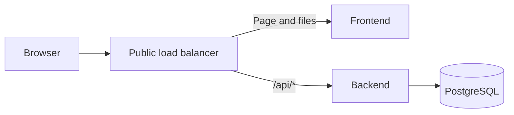

# Idea Board

Idea Board is a web app where you can write an idea, see ideas from others, and delete an idea.

This guide explains how the app works, how to run it locally, and how to test deployments with AI on kind.

## Contents

- [Project structure](#project-structure)
- [Architecture and API](#how-the-app-works)
- [Local development with Docker Compose](#local-development)
- [App tests and performance testing](#testing)
- [Local Kubernetes: complete kind walkthrough](gitops/README.md)
  - [Cluster, Argo CD and root Application](gitops/README.md#1-create-the-cluster)
  - [App HTTP check](gitops/README.md#5-test-the-app)
  - [Live AI planning and deployment](gitops/README.md#6-plan-and-deploy-with-ai)
  - [PR preview deployment and cleanup](gitops/README.md#7-create-a-preview)
  - [Performance and scaling tests](gitops/README.md#8-test-performance-and-scaling)
  - [Live AI rollout diagnosis](gitops/README.md#9-explain-a-failed-rollout-with-ai)
  - [Logs and cluster cleanup](gitops/README.md#inspect-or-stop)
- [Cloud deployment: AWS and GCP](infra/cloud-deployment.md) and [Terraform reference](infra/terraform/README.md)
- [AI integration and design](#ai-integration)
- [Troubleshooting and rollback](#when-something-goes-wrong)
- [Verification results and limits](#what-has-been-tested)

## Project structure

The main directories and entry points are:

```text
Idea-Board/
├── apps/
│   ├── frontend/                 # React app, Dockerfile, and frontend tests
│   └── backend/                  # FastAPI app, Dockerfile, migrations, and backend tests
├── charts/                       # Helm charts for apps and cluster services
│   ├── idea-board-frontend/
│   ├── idea-board-backend/        # Includes optional PostgreSQL for local deployments
│   ├── external-secrets/          # External Secrets Operator
│   ├── external-secret-config/    # SecretStore and ExternalSecret resources
│   └── ingress-controller/        # Local ingress controller
├── gitops/
│   ├── applications/              # Argo CD root chart and kind/AWS/GCP app declarations
│   ├── argocd/                    # Argo CD installation
│   ├── kind/                      # Local cluster configuration and recorded results
│   ├── tests/                     # GitOps deployment checks
│   └── README.md                  # Local kind and AI walkthrough
├── infra/
│   ├── terraform/
│   │   ├── aws/                   # AWS Terragrunt projects
│   │   ├── gcp/                   # GCP Terragrunt projects
│   │   └── modules/               # Reusable Terraform modules
│   │       ├── argocd/            # Installs Argo CD and the root Application
│   │       │   └── bootstrap/     # Helm chart for the root Application and AppProject
│   │       ├── aws/
│   │       │   ├── network/       # VPC, subnets, routing, and NAT
│   │       │   ├── cluster/       # EKS cluster and worker nodes
│   │       │   ├── psql/          # RDS PostgreSQL and database credentials
│   │       │   ├── external-secrets/ # IRSA and Secrets Manager access
│   │       │   └── load-balancer-controller/ # AWS Load Balancer Controller and IAM
│   │       ├── gcp/
│   │       │   ├── network/       # VPC, subnets, routing, and NAT
│   │       │   ├── cluster/       # GKE cluster and worker nodes
│   │       │   ├── psql/          # Cloud SQL PostgreSQL and database credentials
│   │       │   └── external-secrets/ # Workload Identity and Secret Manager access
│   │       └── github/
│   │           └── helm-values/   # Writes generated chart values to GitHub
│   ├── ingress/                   # Cloud routing configuration and guides
│   └── cloud-deployment.md        # AWS and GCP deployment instructions
├── tools/deploy/                  # Deployment planning, checks, diagnosis, rollback, and tests
├── .agents/skills/deploy/         # AI instructions and response schemas
├── .github/workflows/             # CI, image publishing, deployment, and preview workflows
├── docker-compose.yml            # Run the complete app locally
└── README.md                      # Project overview and starting point
```

Start with `apps/` for the application, `charts/` and `gitops/` for Kubernetes deployment, and `tools/deploy/` with `.agents/skills/deploy/` for the AI-assisted deployment flow. Tests live alongside the code they check.

## How the app works

The app has three parts:

| Part     | What it does                                     | Built with         |
| -------- | ------------------------------------------------ | ------------------ |
| Frontend | Shows the page, the ideas, and the form          | React              |
| Backend  | Handles requests to save, read, and delete ideas | Python and FastAPI |
| Database | Keeps the ideas so they are still there later    | PostgreSQL         |

When you open the app:

1. Your browser downloads the frontend files. Nginx is the web server that sends those files.
2. React runs in your browser and builds the page. This is called **client-side rendering**.
3. React asks the backend for ideas. The backend reads them from PostgreSQL and sends them back.
4. React displays the ideas on the page.

Submitting an idea follows the same path: the browser sends the text to the backend, the backend saves it, and the page updates.

In the cloud, a public load balancer receives browser requests and sends each one to the right service:



The page and API share one public address. An **Ingress** is the Kubernetes routing configuration that says which paths go to the frontend and which go to the backend. A controller reads that configuration and sets up the cloud load balancer.

### What the API does

The API is how the browser talks to the backend. Each request uses a path and an action:

| Request                       | What it does                                 |
| ----------------------------- | -------------------------------------------- |
| `GET /api/ideas`              | Read the ideas, newest first                 |
| `POST /api/ideas`             | Save a new idea                              |
| `DELETE /api/ideas/{idea_id}` | Delete the idea with that ID                 |
| `GET /health`                 | Check that the backend can read the database |

To create an idea, send:

```json
{ "content": "Make deployments easier to investigate" }
```

The backend returns the saved idea with its ID and creation time. PostgreSQL stores these in one table called `ideas`: `id`, `content`, and `created_at`.

A few rules apply:

- Idea text must contain 1–2,000 characters after spaces at the ends are removed.
- The same exact text cannot be saved twice. Duplicate requests return `409`.
- Invalid input returns `422`. Deleting an idea that does not exist returns `404`.
- Anyone visiting the app can create or delete ideas.

The frontend loads 50 ideas at a time. The API accepts `limit` and `before_id` to fetch older ideas.

The [frontend guide](apps/frontend/README.md) and [backend guide](apps/backend/README.md) cover each app in more detail.

## Local development

Docker Compose runs the frontend, backend, and database together on your computer. Start Docker, then run:

```bash
git clone https://github.com/rohitraut3366/Idea-Board.git
cd Idea-Board
docker compose up --build --wait
```

Compose starts the services in this order:

```text
Database ready → database setup job finishes → backend ready → frontend starts
```

The database setup job runs **migrations**: versioned changes that create or update database tables. It runs separately before the backend. If the database or required tables are unavailable, the backend fails to start.

| Service           | Address                                           |
| ----------------- | ------------------------------------------------- |
| Web app           | [localhost:3000](http://localhost:3000)           |
| API documentation | [localhost:8000/docs](http://localhost:8000/docs) |
| PostgreSQL        | `127.0.0.1:55432`                                 |

Open the web app, submit an idea, then refresh the page. The idea should still be there.

Locally, Nginx receives browser requests and forwards `/api/` requests to the backend. Compose supplies the database connection settings and stores the data in a Docker volume, so restarting the containers keeps your ideas.

Try creating an idea:

```bash
curl http://localhost:3000/api/ideas \
  -H 'Content-Type: application/json' \
  -d '{"content":"Make deployments easier to investigate"}'
```

Common commands:

```bash
docker compose ps --all                 # Service status
docker compose logs -f frontend backend # Application logs
docker compose logs migrate             # Migration logs
docker compose up --build --wait        # Rebuild after code changes
docker compose down                     # Stop; keep database data
```

To reset the database, **delete its volume** and restart:

```bash
docker compose down --volumes
docker compose up --build --wait
```

## Testing

We test three things: each app on its own, the services working together, and the deployment process.

### E2E Test

Tests the running web app's HTTP endpoints through the backend to PostgreSQL, including creating, listing, and deleting ideas. Run with Compose running:

```bash
npm --prefix apps/frontend ci
npm --prefix apps/frontend run test:stack
```

### Test each app

**Frontend tests** — run from the repository root:

```bash
npm --prefix apps/frontend ci   # Install dependencies
npm --prefix apps/frontend test # Run frontend tests
```

**Backend tests** require Python 3.12 and uv.

From the repository root:

```bash
uv run --directory apps/backend --locked --all-extras --all-groups pytest tests/unit
uv run --directory apps/backend --locked --all-extras --all-groups pytest tests/integration
```

### Performance testing

With Compose running, execute this from the repository root:

```bash
LOAD_CYCLES=100 LOAD_CONCURRENCY=10 npm --prefix apps/frontend run test:load
```

Each cycle creates an idea, reads the list, and deletes the created idea. This example runs 100 cycles, with up to 10 active at once.

| Option                | Default                 | Controls                                         |
| --------------------- | ----------------------- | ------------------------------------------------ |
| `LOAD_CYCLES`         | `100`                   | Total number of cycles                           |
| `LOAD_CONCURRENCY`    | `10`                    | Parallelism: number of cycles running at once    |
| `LOAD_MAX_P95_MS`     | Unset                   | Optional p95 response-time limit in milliseconds |
| `IDEA_BOARD_BASE_URL` | `http://127.0.0.1:3000` | Application address to test                      |

The result shows:

- **Errors:** requests or cleanup steps that failed.
- **Requests per second:** how much traffic the app handled.
- **p95 response time:** the time within which 95% of requests finished.

The command fails if requests or cleanup fail. Set `LOAD_MAX_P95_MS` to also fail when responses exceed your chosen p95 time limit.

### PR workflows

GitHub Actions runs these checks for pull requests and pushes to `master`:

| Area                 | What we check                                                                                 |
| -------------------- | --------------------------------------------------------------------------------------------- |
| Frontend and backend | App tests, types, and code formatting                                                         |
| Docker Compose       | Container builds, migrations, page/API requests, backend replacement, and concurrent requests |
| Kubernetes (kind)    | Helm installation and upgrades; cluster services, releases, previews, cleanup, and rollback   |
| Terraform            | AWS and GCP Terraform validation and module tests using provider mocks                        |
| Deployment tool      | AI response validation, resource settings, release checks, and rollback rules                 |

GitHub Actions creates temporary kind clusters to run the Kubernetes deployment tests. Terraform provider mocks supply fake AWS/GCP responses to check configuration and resource wiring without contacting either cloud or creating resources. Cloud permissions, quotas, managed databases, and public routing require verification in the target accounts.

## Local Kubernetes deployment

Use the [complete kind walkthrough](gitops/README.md) to run the platform locally. It covers:

| Step | What you run |
| ---- | ------------ |
| [Setup](gitops/README.md#1-create-the-cluster) | kind, Argo CD, the root Application, ingress, frontend, backend and PostgreSQL |
| [Deployment checks](gitops/README.md#5-test-the-app-and-deployment-process) | App requests, cluster services, staging, preview redeployment, cleanup, failed rollout and rollback |
| [Live AI deployment](gitops/README.md#6-plan-and-deploy-with-ai) | Ask for settings, review the generated plan and deploy staging |
| [Preview](gitops/README.md#7-create-a-preview) | Generate a preview plan and deploy its frontend, backend and isolated database |
| [Performance](gitops/README.md#8-test-performance-and-scaling) | Send concurrent requests and compare backend replica counts |
| [Live AI diagnosis](gitops/README.md#9-explain-a-failed-rollout-with-ai) | Ask AI to explain evidence captured from the failed-rollout check |

The app opens at [localhost:8081](http://localhost:8081). The [verification results](gitops/kind/verification.md) record previous runs. The [cloud deployment guide](infra/cloud-deployment.md) covers AWS and GCP setup; there are no current hosted application URLs.

## Cloud deployment

AWS and GCP use the same app images, Helm charts, PostgreSQL schema, and release checks. Terraform modules define each cloud's infrastructure; Terragrunt declares its settings and dependencies.

The [cloud deployment guide](infra/cloud-deployment.md) covers infrastructure setup, cluster access, GitHub Actions, releases, previews, and cleanup.

## AI integration

AI helps with two jobs: choosing deployment settings and explaining rollout failures. The [deployment skill](.agents/skills/deploy/SKILL.md) tells it what to consider and how to format its response. The GitHub workflow runs the skill through the Codex Action using `OPENAI_API_KEY`.

### Example 1: Plan a small staging environment

Follow [live AI planning and deployment on kind](gitops/README.md#6-plan-and-deploy-with-ai) and use this request:

> Low-traffic staging for a few reviewers. Keep resource use small.

The AI recommends the number of frontend/backend copies, their CPU and memory, and cloud machine/database sizes. It explains why those settings fit the request. For example, our [recorded local recommendation](gitops/kind/evidence/recommendation.json) chose one copy of each service and more memory for the Python backend.

The deployment tool validates the response and turns it into Helm values and a release plan. The release command deploys the app through Argo CD and checks it.

The generated files include:

| File                             | What it gives you                                                 |
| -------------------------------- | ----------------------------------------------------------------- |
| `recommendation.json`            | The AI's settings and reasons                                     |
| `release-plan/plan.md`           | The deployment steps and generated commands                       |
| `release-plan/applications.json` | The Argo CD deployment configuration                              |
| `release-plan/terraform/`        | Cloud machine/database sizing proposals for staging or production |

Review infrastructure proposals through a Terraform plan before applying them. Preview environments share staging infrastructure; kind uses the local cluster.

Cloud workflow runs save these files in **Artifacts**. See [cloud releases](infra/cloud-deployment.md#4-release-the-application) for setup and workflow instructions.

### Example 2: Explain a failed rollout

Suppose the new frontend image cannot start. The deployment tool collects the failed checks, pod readiness, restart counts and recognized error signatures such as `ImagePullBackOff`. It also collects CPU and memory use when available.

The workflow passes that evidence to the AI. A diagnosis can say:

> The new frontend is waiting for its image. The previous frontend and backend are still ready. Check that the image exists and can be pulled. A previous verified release is available; confirm database schema compatibility before restoring it.

The workflow validates the diagnosis and saves `diagnosis.json` and `diagnosis.md` in its **Artifacts**. Our [recorded diagnosis](gitops/kind/evidence/diagnosis.json) shows this case.

You use the explanation to decide what to fix or whether to run the explicit rollback operation. Health checks determine whether the release works; the AI explains the evidence. The [local AI diagnosis example](gitops/README.md#9-explain-a-failed-rollout-with-ai) uses evidence captured by the kind deployment check.

## When something goes wrong

**Failed release:** inspect the workflow diagnostics, Argo CD Application status, pod events, and migration job logs.

**Restore a previous version (rollback):** the deployment tool saves the last release that passed its checks. Run Deploy with `operation=rollback`, the failed image SHA, and `schema_compatible=true` after confirming the previous app supports the current schema. Rollback restores the application version and preserves the database schema and data. See the [rollback procedure](tools/deploy/README.md).

## What has been tested

The local Kubernetes demonstration is verified in kind:

| Check              | Result                                                                                               |
| ------------------ | ---------------------------------------------------------------------------------------------------- |
| App and PostgreSQL | Page/API checks passed; saved data survived PostgreSQL pod replacement and backend restarts          |
| Argo CD            | Local root, ingress and environment parents with backend/frontend children became Synced and Healthy |
| Preview lifecycle  | Separate database/login, redeployment, and cleanup passed                                            |
| Rollback           | Failed-image detection and recovery passed; schema and test data were preserved                      |
| Load and scaling   | Measured with one and two backend replicas; see the [results](gitops/kind/verification.md)           |
| AI integration     | Session-generated recommendation and diagnosis passed the tool's validation                          |

The [kind guide](gitops/README.md) contains the commands to reproduce the demo. The [recorded evidence](gitops/kind/verification.md) distinguishes the AI session from automated checks using fixed recommendations.

AWS and GCP infrastructure has Terraform validation and provider-mock coverage. Live deployment of the independent cloud projects, cloud ingress, hosted AI runner authentication, and External Secrets access to database credentials remain unverified. There are no current hosted application URLs.
