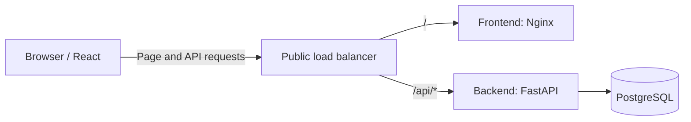

# Idea Board

A web app for sharing, browsing, and deleting ideas, built with React, FastAPI, and PostgreSQL. Docker Compose runs it locally. Terraform provisions AWS or GCP, and GitHub Actions deploys through Argo CD.

## Overview

React runs in the browser. The browser loads the page from the frontend, then sends API requests to the same public address.



Ingress defines the routes. The AWS Load Balancer Controller or GKE Ingress controller creates the load balancer and connects it to the application pods. Each service has its own Helm chart and Argo CD Application.

The delivery flow is:

```text
Commit → tests → GHCR images → AI resource proposal → validation
       → Argo CD → migration job → backend → frontend → HTTP checks → URL
```

Terraform creates the infrastructure before the first release. Application releases reuse it.

## Application

**Frontend:** React, TypeScript, and Vite. Nginx serves the built files. Users can submit an idea, browse the newest ideas, load older entries, and delete an idea after confirmation.

**Backend:** FastAPI validates requests and reads or writes PostgreSQL through SQLAlchemy and psycopg.

| Endpoint                      | Purpose                                 | Success                  |
| ----------------------------- | --------------------------------------- | ------------------------ |
| `GET /api/ideas`              | List ideas, newest first                | `200`, JSON array        |
| `POST /api/ideas`             | Create an idea from `{"content":"..."}` | `201`, created idea      |
| `DELETE /api/ideas/{idea_id}` | Delete an idea                          | `204`                    |
| `GET /health`                 | Check database access                   | `200`, `{"status":"ok"}` |

Listing supports pagination with `limit` (1–100) and `before_id`. The frontend requests 50 ideas at a time.

Content is trimmed and must contain 1–2,000 characters. Exact duplicates return `409`, invalid input returns `422`, and deleting a missing idea returns `404`. Anyone visiting the app can create or delete ideas.

**Database:** PostgreSQL stores one `ideas` table with `id`, `content`, and `created_at`. API responses use string IDs and UTC timestamps.

Alembic migrations run in a separate job before the backend starts: the `migrate` service in Compose and a `PreSync` hook in Argo CD. The API checks the database and schema at startup and exits if they are unavailable.

See the [frontend guide](apps/frontend/README.md) and [backend guide](apps/backend/README.md) for configuration and app-specific development commands.

## Local development

Start Docker, then run:

```bash
git clone https://github.com/rohitraut3366/Idea-Board.git
cd Idea-Board
docker compose up --build --wait
```

Compose starts PostgreSQL, runs migrations, waits for the backend, then starts the frontend.

| Service           | Address                                           |
| ----------------- | ------------------------------------------------- |
| Web app           | [localhost:3000](http://localhost:3000)           |
| API documentation | [localhost:8000/docs](http://localhost:8000/docs) |
| PostgreSQL        | `127.0.0.1:55432`                                 |

Locally, Nginx forwards `/api/` requests to the backend. Compose supplies database credentials through environment variables. A named volume preserves ideas between restarts.

Try creating an idea:

```bash
curl http://localhost:3000/api/ideas \
  -H 'Content-Type: application/json' \
  -d '{"content":"Make deployments easier to investigate"}'
```

Common commands:

```bash
docker compose ps --all                 # Service status
docker compose logs -f frontend backend # Application logs
docker compose logs migrate             # Migration logs
docker compose up --build --wait         # Rebuild after code changes
docker compose down                      # Stop; keep database data
```

To reset the database, **delete its volume** and restart:

```bash
docker compose down --volumes
docker compose up --build --wait
```

## Testing

CI runs application tests, static checks, container builds, Compose HTTP tests, Helm checks, Terraform validation and mock plans, and Argo CD release tests in kind. App-specific test commands are in the frontend and backend guides.

With Compose running, install the frontend test dependencies and check the complete stack:

```bash
npm --prefix apps/frontend ci
npm --prefix apps/frontend run test:stack
```

Run concurrent create/read/delete requests:

```bash
LOAD_CYCLES=100 LOAD_CONCURRENCY=10 npm --prefix apps/frontend run test:load
```

The load test reports errors, throughput, and p95 latency, and cleans up its ideas. Set `LOAD_MAX_P95_MS` to enforce a latency target or `IDEA_BOARD_BASE_URL` to test another deployment.

For cloud capacity testing, run the generator outside the cluster and increase concurrency in steps. Record latency, errors, pod CPU/memory, database CPU/connections, and the deployed resource sizes.

## Deployment

Complete infrastructure, ingress, and GitHub setup once per environment. Then use the release workflow for application changes.

### 1. Provision infrastructure

Terraform has separate AWS and GCP roots with three modules each:

| Module    | AWS                        | GCP                             |
| --------- | -------------------------- | ------------------------------- |
| `network` | VPC, subnets, routing, NAT | VPC, subnet, routing, Cloud NAT |
| `cluster` | EKS and managed workers    | GKE and worker pool             |
| `psql`    | Private RDS PostgreSQL     | Private Cloud SQL PostgreSQL    |

Configure cloud credentials and an encrypted, versioned remote state bucket. Use separate state keys and stack names for staging and production.

For AWS, start from the repository root:

```bash
cd infra/terraform/aws
cp terraform.tfvars.example terraform.tfvars
cp backend.hcl.example backend.hcl
```

For GCP, use `infra/terraform/gcp`. Fill in the example files with your region, cluster settings, identity, and state bucket. GCP also requires a billed project, Application Default Credentials, and `TF_VAR_database_password` in the environment.

Use Terraform 1.17.x, then run:

```bash
terraform init -backend-config=backend.hcl
terraform validate
terraform plan -out=stack.tfplan
terraform apply stack.tfplan
terraform output
```

Review the plan and costs before applying. Keep the cluster and database outputs for GitHub configuration. The [Terraform guide](infra/terraform/README.md) explains inputs, authentication, state, and teardown.

### 2. Set up Argo CD and ingress

Connect `kubectl` to the new cluster and install Argo CD using the [GitOps guide](gitops/README.md).

- **AWS:** apply the separate `infra/ingress/aws` Terraform project for controller IAM and Pod Identity, then install its generated Argo CD Application. Wait for the AWS Load Balancer Controller to be healthy.
- **GCP:** the cluster module enables GKE's built-in HTTP load-balancing controller.

Follow the [ingress setup guide](infra/ingress/README.md) for the commands. During release, the frontend chart creates the Ingress, and the controller creates a public HTTP load balancer for that namespace.

### 3. Configure GitHub Actions

Configure GitHub OIDC access for this repository:

- **AWS:** a deployment role with EKS access, Kubernetes permissions, and permission to read the database credential secret.
- **GCP:** Workload Identity Federation and a service account with cluster and Secret Manager access.

Create the GitHub Environments you will use: `aws-staging`, `aws-production`, `gcp-staging`, and `gcp-production`. Add reviewers to production environments.

Set these Environment variables:

| Variable                                          | Value                          |
| ------------------------------------------------- | ------------------------------ |
| `CLOUD_REGION`                                    | AWS region or GKE location     |
| `CLUSTER_NAME`                                    | Terraform cluster output       |
| `DATABASE_HOST`, `DATABASE_PORT`, `DATABASE_NAME` | Terraform database outputs     |
| `DATABASE_CREDENTIAL_SECRET_ID`                   | Database secret reference      |
| `DATABASE_USERNAME`                               | GCP database username          |
| `AWS_ROLE_ARN`                                    | AWS deployment role            |
| `GCP_PROJECT_ID`                                  | GCP project                    |
| `GCP_WORKLOAD_IDENTITY_PROVIDER`                  | GCP federation provider        |
| `GCP_SERVICE_ACCOUNT`                             | GCP deployment service account |

Add `OPENAI_API_KEY` as an Actions secret. The deployment job reads the cloud database secret and creates the Kubernetes Secret consumed by the backend and migration job.

### 4. Release the application

CI publishes frontend and backend images to public GHCR packages, tagged with the full commit SHA. Both images support `amd64` and `arm64`. Builds reuse dependency layers and GitHub Actions caches.

1. Wait for CI and image publishing to pass for the commit.
2. Open **Actions → Deploy**. Choose the cloud and environment, enter the full image SHA, and describe the workload.
3. Review the resource proposal and release artifacts. Apply proposed infrastructure sizing through a separate reviewed Terraform plan when needed.
4. The workflow deploys the backend and its migration job, then the frontend. It waits for Argo CD sync, healthy workloads, and the requested image and configuration.
5. It checks the page and API through the public Ingress address, then reports the application URL.

For example:

```bash
gh workflow run deploy.yml --ref master \
  -f cloud=aws -f environment=staging \
  -f image_tag=FULL_40_CHARACTER_COMMIT_SHA \
  -f request='Low-traffic staging for a few reviewers'
```

Use `cloud=gcp` for GCP. See the [deployment tool guide](tools/deploy/README.md) for workflow inputs and verification details.

### Environments and previews

Staging and production use separate Terraform stacks, state, namespaces, and GitHub Environments.

Set the repository variable `PREVIEW_CLOUD` to `aws` or `gcp` to enable previews for same-repository PRs. Each preview deploys both apps into its own namespace with a dedicated database, login, Secret, and public load balancer. Previews share the staging cluster and database server; the staging database identity needs permission to create databases and roles.

Successful PR CI triggers deployment. Updates preserve preview data. Closing the PR removes its application and database resources. See the [deployment guide](tools/deploy/README.md) for permissions and cleanup.

## AI integration

The [deployment skill](.agents/skills/deploy/SKILL.md) turns an operator's workload description into a resource proposal and release plan. It proposes frontend/backend replicas, CPU and memory, plus cloud worker and database sizing with reasons for each choice.

The skill defines instructions and JSON schemas that compatible AI runners can use. GitHub Actions currently runs it with the Codex Action. The deployment tool validates the output and converts approved fields into Helm values and Terraform sizing inputs. Workflow inputs select the target, namespace, and image.

After deployment, the tool collects rollout status, restart counts, events, error signatures, and available resource metrics. The AI uses this evidence to explain failures and suggest next steps. Health checks determine release success; an operator initiates rollback.

This gives operators a starting configuration and a diagnosis tied to deployment evidence. The [deployment guide](tools/deploy/README.md) explains validation rules, evidence handling, and runner setup.

## Operations

**Failed release:** inspect the workflow diagnostics, Argo CD Application status, pod events, and migration job logs.

**Rollback:** the deployment tool saves the last verified release. Run Deploy with `operation=rollback`, the failed image SHA, and `schema_compatible=true` after confirming the previous app supports the current schema. Rollback restores the application version and preserves the database schema and data. See the [rollback procedure](tools/deploy/README.md).

**Teardown:** remove application Ingress resources and wait for their load balancers to disappear while the controller is running. Then remove the AWS controller setup and destroy the Terraform stack. The [Terraform guide](infra/terraform/README.md) covers deletion protection, snapshots, and retained resources.

## Cloud portability

Both clouds use the same application images, PostgreSQL schema, Helm charts, and release checks. Provider-specific networking, Kubernetes, database, identity, and ingress settings live in their infrastructure modules and deployment adapters.

Choose the cloud and its GitHub Environment to select the target. Adding another provider requires infrastructure modules and authentication, secret, and ingress adapters.

## Verification status

Compose, application tests, local load checks, Helm checks, and Argo CD release/preview/rollback tests have run locally or in CI. AWS infrastructure has been provisioned, tested through a port-forward, and destroyed. GCP has Terraform validation and mock-test coverage.

Live cloud ingress, a GCP deployment, a successful live AI response, and measured cloud capacity remain to be verified. There are currently no hosted application URLs.
