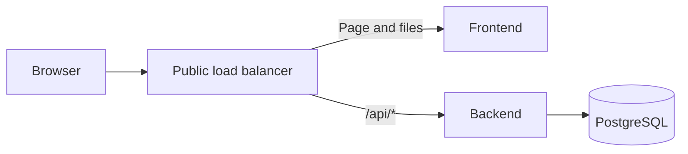

# Idea Board

Idea Board is a web app where you can write an idea, see ideas from others, and delete an idea.

This guide explains how the app works, how to run it on your computer, and how to deploy it to AWS or GCP.

## How the app works

The app has three parts:

| Part     | What it does                                     | Built with         |
| -------- | ------------------------------------------------ | ------------------ |
| Frontend | Shows the page, the ideas, and the form          | React              |
| Backend  | Handles requests to save, read, and delete ideas | Python and FastAPI |
| Database | Keeps the ideas so they are still there later    | PostgreSQL         |

When you open the app:

1. Your browser downloads the frontend files. Nginx is the web server that sends those files.
2. React runs in your browser and builds the page. This is called **client-side rendering**.
3. React asks the backend for ideas. The backend reads them from PostgreSQL and sends them back.
4. React displays the ideas on the page.

Submitting an idea follows the same path: the browser sends the text to the backend, the backend saves it, and the page updates.

In the cloud, a public load balancer receives browser requests and sends each one to the right service:



The page and API share one public address. An **Ingress** is the Kubernetes routing configuration that says which paths go to the frontend and which go to the backend. A controller reads that configuration and sets up the cloud load balancer.

### What the API does

The API is how the browser talks to the backend. Each request uses a path and an action:

| Request                       | What it does                                 |
| ----------------------------- | -------------------------------------------- |
| `GET /api/ideas`              | Read the ideas, newest first                 |
| `POST /api/ideas`             | Save a new idea                              |
| `DELETE /api/ideas/{idea_id}` | Delete the idea with that ID                 |
| `GET /health`                 | Check that the backend can read the database |

To create an idea, send:

```json
{ "content": "Make deployments easier to investigate" }
```

The backend returns the saved idea with its ID and creation time. PostgreSQL stores these in one table called `ideas`: `id`, `content`, and `created_at`.

A few rules apply:

- Idea text must contain 1–2,000 characters after spaces at the ends are removed.
- The same exact text cannot be saved twice. Duplicate requests return `409`.
- Invalid input returns `422`. Deleting an idea that does not exist returns `404`.
- Anyone visiting the app can create or delete ideas.

The frontend loads 50 ideas at a time. The API accepts `limit` and `before_id` to fetch older ideas.

The [frontend guide](apps/frontend/README.md) and [backend guide](apps/backend/README.md) cover each app in more detail.

## Local development

Docker Compose runs the frontend, backend, and database together on your computer. Start Docker, then run:

```bash
git clone https://github.com/rohitraut3366/Idea-Board.git
cd Idea-Board
docker compose up --build --wait
```

Compose starts the services in this order:

```text
Database ready → database setup job finishes → backend ready → frontend starts
```

The database setup job runs **migrations**: versioned changes that create or update database tables. It runs separately before the backend. If the database or required tables are unavailable, the backend fails to start.

| Service           | Address                                           |
| ----------------- | ------------------------------------------------- |
| Web app           | [localhost:3000](http://localhost:3000)           |
| API documentation | [localhost:8000/docs](http://localhost:8000/docs) |
| PostgreSQL        | `127.0.0.1:55432`                                 |

Open the web app, submit an idea, then refresh the page. The idea should still be there.

Locally, Nginx receives browser requests and forwards `/api/` requests to the backend. Compose supplies the database connection settings and stores the data in a Docker volume, so restarting the containers keeps your ideas.

Try creating an idea:

```bash
curl http://localhost:3000/api/ideas \
  -H 'Content-Type: application/json' \
  -d '{"content":"Make deployments easier to investigate"}'
```

Common commands:

```bash
docker compose ps --all                 # Service status
docker compose logs -f frontend backend # Application logs
docker compose logs migrate             # Migration logs
docker compose up --build --wait        # Rebuild after code changes
docker compose down                     # Stop; keep database data
```

To reset the database, **delete its volume** and restart:

```bash
docker compose down --volumes
docker compose up --build --wait
```

## Testing

We test three things: each app on its own, the services working together, and the deployment process.

### Test the complete app

Start the stack:

```bash
docker compose up --build --wait
```

From the repository root, run:

```bash
npm --prefix apps/frontend ci             # Install dependencies
npm --prefix apps/frontend run test:stack # Test the running stack
```

These commands require Node.js 24.

This tests the running frontend and backend together over HTTP.

To check logs:

```bash
docker compose logs frontend backend migrate
```

### Test each app

**Frontend tests** — run from the repository root:

```bash
npm --prefix apps/frontend ci   # Install dependencies
npm --prefix apps/frontend test # Run frontend tests
```

**Backend tests** require Python 3.12 and uv.

From the repository root:

```bash
uv run --directory apps/backend --locked --all-extras --all-groups pytest tests/unit
uv run --directory apps/backend --locked --all-extras --all-groups pytest tests/integration
```

### Performance testing

With Compose running, execute this from the repository root:

```bash
LOAD_CYCLES=100 LOAD_CONCURRENCY=10 npm --prefix apps/frontend run test:load
```

Each cycle creates an idea, reads the list, and deletes the created idea. This example runs 100 cycles, with up to 10 active at once.

| Option                | Default                 | Controls                                         |
| --------------------- | ----------------------- | ------------------------------------------------ |
| `LOAD_CYCLES`         | `100`                   | Total number of cycles                           |
| `LOAD_CONCURRENCY`    | `10`                    | Parallelism: number of cycles running at once    |
| `LOAD_MAX_P95_MS`     | Unset                   | Optional p95 response-time limit in milliseconds |
| `IDEA_BOARD_BASE_URL` | `http://127.0.0.1:3000` | Application address to test                      |

The result shows:

- **Errors:** requests or cleanup steps that failed.
- **Requests per second:** how much traffic the app handled.
- **p95 response time:** the time within which 95% of requests finished.

The command fails if requests or cleanup fail. Set `LOAD_MAX_P95_MS` to also fail when responses exceed your chosen p95 time limit.

### PR workflows

GitHub Actions runs these checks for pull requests and pushes to `master`:

| Area                 | What we check                                                                                 |
| -------------------- | --------------------------------------------------------------------------------------------- |
| Frontend and backend | App tests, types, and code formatting                                                         |
| Docker Compose       | Container builds, migrations, page/API requests, backend replacement, and concurrent requests |
| Kubernetes           | Helm installation and upgrades; cluster services, releases, previews, cleanup, and rollback   |
| Terraform            | AWS and GCP configuration and module tests using simulated cloud responses                    |
| Deployment tool      | AI response validation, resource settings, release checks, and rollback rules                 |

Kubernetes deployment tests run in kind, a Kubernetes cluster running in Docker. Terraform tests use simulated cloud responses. Cloud permissions, managed databases, and public routing require verification in the target accounts.

## Local Kubernetes deployment

The Kubernetes demo runs in **kind**. Apply one root Argo CD Application to deploy Traefik ingress, the backend with its PostgreSQL child chart, and the frontend. Local values provide development database credentials. Follow the [kind guide](gitops/README.md) to start it and open [localhost:8081](http://localhost:8081).

The [verification results](gitops/kind/verification.md) record the app checks, preview lifecycle, rollback, and measured local load tests. AWS and GCP configuration is included below; there are no current hosted application URLs.

## Cloud deployment

Deployment has two stages:

1. **Set up a place to run the app:** create the cloud network, Kubernetes cluster, database, and deployment access.
2. **Release an app version:** build its containers and tell the cluster to run them.

Follow steps 1–3 to set up an environment. Use step 4 whenever you want to release an app version.

### 1. Create the cloud resources

Terraform defines the resources. Terragrunt supplies their settings, state locations, and dependency order. Each cloud has four projects:

```text
infra/terraform/
├── state.hcl                         # Shared S3 state bucket and its region
├── root.hcl                          # Shared state and input rules
├── aws/staging/
│   ├── environment.hcl               # Stack name
│   └── ap-southeast-2/
│       ├── region.hcl                # Region and availability zones
│       ├── networking/terragrunt.hcl
│       ├── cluster/terragrunt.hcl
│       ├── cluster-core-services/terragrunt.hcl
│       └── applications/idea-board/terragrunt.hcl
├── gcp/staging/                      # Same project layout for GCP
└── modules/                          # Reusable Terraform resources
```

The checked-in declarations contain the stack name, regions, Kubernetes versions, machine sizes, and database settings. Change these files to change the deployment. AWS resolves cluster administrator access from your logged-in IAM identity. GCP uses `GOOGLE_CLOUD_PROJECT` or the project selected in gcloud. Database credentials are generated and stored in the cloud secret manager.

Before deploying:

1. Install Terraform 1.17.x, Terragrunt 1.2.2, kubectl, GitHub CLI, and your cloud CLI.
2. Sign in to AWS for infrastructure and state access. For GCP, also configure Application Default Credentials in a billed project.
3. Check `infra/terraform/state.hcl` points to your existing S3 state bucket. Both clouds use this bucket; project paths determine separate state keys.
4. Sign in to GitHub CLI and export its token for Terraform to publish shared-service values:

   ```bash
   export GITHUB_TOKEN="$(gh auth token)"
   ```

For AWS, select your authenticated profile and deploy:

```bash
export AWS_PROFILE=idea-board
cd infra/terraform/aws/staging/ap-southeast-2
terragrunt run --all apply
```

For GCP, run the same Terragrunt command from `infra/terraform/gcp/staging/australia-southeast1`. GCP deployments also use AWS credentials for the shared S3 state bucket.

Terragrunt initializes each project and applies them in dependency order:

```text
networking → cluster → cluster-core-services → applications/idea-board
```

A fresh stack needs its dependencies created before their consumers can be planned. For an existing stack, preview all changes with `terragrunt run --all plan`. To review and apply one project, run these commands from its directory:

```bash
terragrunt run -- plan -out=project.tfplan
terragrunt run -- apply project.tfplan
terragrunt run -- output
```

The cluster project provides `cluster_name`. The application project provides the database connection details and secret reference used in step 3. The [Terraform guide](infra/terraform/README.md) covers settings, state, existing deployments, and teardown.

### 2. Connect to the cluster and check public routing

**Argo CD** runs inside the cluster. It reads the app's configuration from Git and makes the running services match it. Each service has a **Helm chart**, a template describing what Kubernetes should run.

The `cluster-core-services` project installs Argo CD and waits for it to be ready. On AWS it also installs the AWS Load Balancer Controller and its IAM permissions. GKE's HTTP load-balancing controller is enabled by the `cluster` project.

Terraform also creates a root Argo CD Application called `idea-board`. Its cloud values file selects which child Applications run. This is the **app-of-apps** pattern:

```text
Terraform → Argo CD → idea-board → External Secrets Operator
```

Each `gitops/applications/values-kind.yaml`, `values-aws.yaml` and `values-gcp.yaml` file declares its own services. The default `values.yaml` contains shared settings and an empty applications map. Each service has its own chart under `charts/`. The External Secrets umbrella chart wraps the upstream chart with our defaults.

External Secrets reads these files from its chart directory, in order. Later files override earlier ones:

```text
values.yaml
values/<cloud>/values.yaml
values/<cloud>/<cluster-name>/values.yaml
values/<cloud>/<cluster-name>/values-terraform.yaml
```

Provider and cluster files are optional. Argo CD ignores missing files and picks them up when they appear on the watched Git branch.

The External Secrets module creates the operator's cloud identity and secret-read permissions automatically: IRSA on AWS, Workload Identity on GCP. It writes the service-account annotation to `values-terraform.yaml` on `master`. Argo CD loads that file when rendering the operator chart. Keep `gitops_revision = "master"` to receive these updates.

The [GitOps Applications guide](gitops/applications/README.md) explains application selection and chart overrides.

Connect `kubectl`, the Kubernetes command-line tool, to the cluster. Use its name from the previous step:

```bash
# AWS
aws eks update-kubeconfig --name YOUR_CLUSTER --region YOUR_REGION

# GCP
gcloud container clusters get-credentials YOUR_CLUSTER \
  --region YOUR_REGION --project YOUR_PROJECT
```

Check the Applications, then wait for External Secrets Operator to be ready:

```bash
kubectl --context YOUR_CONTEXT --namespace argocd get applications
kubectl --context YOUR_CONTEXT --namespace argocd wait application/external-secrets \
  --for=jsonpath='{.status.sync.status}'=Synced --timeout=10m
kubectl --context YOUR_CONTEXT --namespace argocd wait application/external-secrets \
  --for=jsonpath='{.status.health.status}'=Healthy --timeout=10m
```

When the app is released, its Ingress tells the controller to create a public load balancer and route browser requests to the frontend or API. The [ingress guide](infra/ingress/README.md) explains the routes, health checks, and cleanup.

### 3. Configure GitHub Actions

**GitHub Actions** runs the deployment workflow. Give it access to the cloud through **OIDC**, which lets a workflow obtain temporary cloud credentials:

- **AWS:** a deployment role with EKS access, Kubernetes permissions, and permission to read the database credential secret.
- **GCP:** Workload Identity Federation and a service account with cluster and Secret Manager access.

A **GitHub Environment** groups the settings and approval rules for a deployment target. Create the environments you will use: `aws-staging`, `aws-production`, `gcp-staging`, and `gcp-production`. Add reviewers to production environments.

Set these Environment variables:

| Variable                                          | Value                             |
| ------------------------------------------------- | --------------------------------- |
| `CLOUD_REGION`                                    | AWS region or GKE location        |
| `CLUSTER_NAME`                                    | `cluster`: `cluster_name` output  |
| `DATABASE_HOST`, `DATABASE_PORT`, `DATABASE_NAME` | `applications/idea-board` outputs |
| `DATABASE_CREDENTIAL_SECRET_ID`                   | Database secret reference         |
| `DATABASE_USERNAME`                               | GCP database username             |
| `AWS_ROLE_ARN`                                    | AWS deployment role               |
| `GCP_PROJECT_ID`                                  | GCP project                       |
| `GCP_WORKLOAD_IDENTITY_PROVIDER`                  | GCP federation provider           |
| `GCP_SERVICE_ACCOUNT`                             | GCP deployment service account    |

Add `OPENAI_API_KEY` as an Actions secret. The deployment job reads the cloud database secret and creates the Kubernetes Secret consumed by the backend and migration job.

### 4. Release the application

After tests pass, CI publishes the frontend and backend container images to **GitHub Container Registry (GHCR)**. An image is the packaged app that Kubernetes runs.

Each image is tagged with the full Git commit SHA, so a release can select an exact code version. Both images support `amd64` and `arm64`. Builds cache dependencies to speed up later builds.

1. Wait for CI and image publishing to pass for the commit.
2. Open **Actions → Deploy**. Choose the cloud and environment, enter the full image SHA, and describe the workload.
3. The AI suggests how many copies of each service to run and how much CPU and memory they need. Review the saved recommendation. If it also suggests changing cloud machine or database sizes, review and apply those changes through Terraform separately.
4. The workflow runs the database migration job, starts the backend, and then starts the frontend. It waits until Argo CD has applied the requested version and both services are healthy.
5. It checks the page and API through the public Ingress address, then reports the application URL.

For example:

```bash
gh workflow run deploy.yml --ref master \
  -f cloud=aws -f environment=staging \
  -f image_tag=FULL_40_CHARACTER_COMMIT_SHA \
  -f request='Low-traffic staging for a few reviewers'
```

Use `cloud=gcp` for GCP. See the [deployment tool guide](tools/deploy/README.md) for workflow inputs and verification details.

### Environments and previews

- **Staging** is where you check a release before production.
- **Production** is where the stable app runs.
- **PR previews** let someone try the frontend and backend from one pull request.

Staging and production each have their own infrastructure and deployment settings. A **namespace** groups an environment's resources inside Kubernetes.

Set the repository variable `PREVIEW_CLOUD` to `aws` or `gcp` to enable previews for same-repository PRs. Each preview deploys both apps into its own namespace with a dedicated database, login, Secret, and public load balancer. Previews share the staging cluster and database server; the staging database identity needs permission to create databases and roles.

Successful PR CI triggers deployment. Updates preserve preview data. Closing the PR removes its application and database resources. See the [deployment guide](tools/deploy/README.md) for permissions and cleanup.

## AI integration

AI helps with two jobs: choosing deployment settings and explaining rollout failures. The [deployment skill](.agents/skills/deploy/SKILL.md) tells it what to consider and how to format its response. The GitHub workflow runs the skill through the Codex Action using `OPENAI_API_KEY`.

### Example 1: Plan a small staging environment

Open **Actions → Deploy → Run workflow**, choose your cloud and `staging`, enter a published image SHA, and put this in `request`:

> Low-traffic staging for a few reviewers. Keep resource use small.

The AI recommends the number of frontend/backend copies, their CPU and memory, and cloud machine/database sizes. It explains why those settings fit the request. For example, our [recorded local recommendation](gitops/kind/evidence/recommendation.json) chose one copy of each service and more memory for the Python backend.

The deployment tool validates the response and turns it into Helm values and a release plan. The workflow then deploys the app through Argo CD and checks it.

Open the workflow run's **Artifacts** to download:

| File                             | What it gives you                                                 |
| -------------------------------- | ----------------------------------------------------------------- |
| `recommendation.json`            | The AI's settings and reasons                                     |
| `release-plan/plan.md`           | The deployment steps and generated commands                       |
| `release-plan/applications.json` | The Argo CD deployment configuration                              |
| `release-plan/terraform/`        | Cloud machine/database sizing proposals for staging or production |

Review infrastructure proposals through a Terraform plan before applying them. Preview environments share staging infrastructure; kind uses the local cluster.

To try the planning flow locally, follow [Plan a release locally](tools/deploy/README.md#plan-a-release-locally). It shows how to generate the prompt, run the AI and inspect the resulting files.

### Example 2: Explain a failed rollout

Suppose the new frontend image cannot start. The deployment tool collects the failed checks, pod readiness, restart counts and recognized error signatures such as `ImagePullBackOff`. It also collects CPU and memory use when available.

The workflow passes that evidence to the AI. A diagnosis can say:

> The new frontend is waiting for its image. The previous frontend and backend are still ready. Check that the image exists and can be pulled. A previous verified release is available; confirm database schema compatibility before restoring it.

The workflow validates the diagnosis and saves `diagnosis.json` and `diagnosis.md` in its **Artifacts**. Our [recorded diagnosis](gitops/kind/evidence/diagnosis.json) shows this case.

You use the explanation to decide what to fix or whether to run the explicit rollback operation. Health checks determine whether the release works; the AI explains the evidence. The [diagnosis guide](tools/deploy/README.md#diagnose-a-rollout) shows how to run this locally.

## When something goes wrong

**Failed release:** inspect the workflow diagnostics, Argo CD Application status, pod events, and migration job logs.

**Restore a previous version (rollback):** the deployment tool saves the last release that passed its checks. Run Deploy with `operation=rollback`, the failed image SHA, and `schema_compatible=true` after confirming the previous app supports the current schema. Rollback restores the application version and preserves the database schema and data. See the [rollback procedure](tools/deploy/README.md).

**Remove the cloud setup:** remove application Ingress resources and wait for their load balancers to disappear while the controller is running. Then destroy `applications/idea-board`, `cluster-core-services`, `cluster`, and `networking`, in that order. The [Terraform guide](infra/terraform/README.md) covers deletion protection, snapshots, and retained resources.

## How AWS and GCP use the same app

Both clouds use the same application images, PostgreSQL schema, Helm charts, and release checks. Provider-specific networking, Kubernetes, database, identity, and ingress settings live in their infrastructure modules and deployment adapters.

Choose the cloud and its GitHub Environment to select the target. Adding another provider requires infrastructure modules and authentication, secret, and ingress adapters.

## What has been tested

The local Kubernetes demonstration is verified in kind:

| Check              | Result                                                                                               |
| ------------------ | ---------------------------------------------------------------------------------------------------- |
| App and PostgreSQL | Page/API checks passed; saved data survived PostgreSQL pod replacement and backend restarts          |
| Argo CD            | Local root, ingress and environment parents with backend/frontend children became Synced and Healthy |
| Preview lifecycle  | Separate database/login, redeployment, and cleanup passed                                            |
| Rollback           | Failed-image detection and recovery passed; schema and test data were preserved                      |
| Load and scaling   | Measured with one and two backend replicas; see the [results](gitops/kind/verification.md)           |
| AI integration     | Session-generated recommendation and diagnosis passed the tool's validation                          |

The [kind guide](gitops/README.md) contains the commands to reproduce the demo. The [recorded evidence](gitops/kind/verification.md) distinguishes the AI session from automated checks using fixed recommendations.

AWS and GCP infrastructure has Terraform validation and provider-mock coverage. Live deployment of the independent cloud projects, cloud ingress, hosted AI runner authentication, and External Secrets access to database credentials remain unverified. There are no current hosted application URLs.
