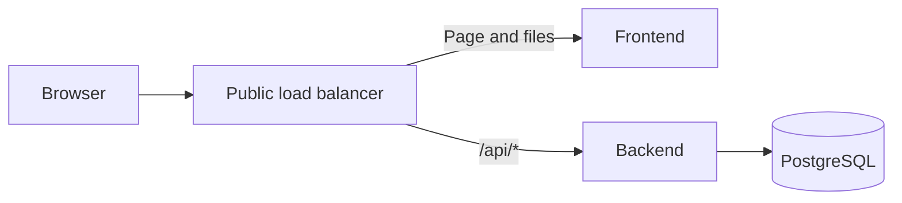

# Idea Board

Idea Board is a web app where you can write an idea, see ideas from others, and delete an idea.

This guide explains how the app works, how to run it on your computer, and how to deploy it to AWS or GCP.

## How the app works

The app has three parts:

| Part     | What it does                                     | Built with         |
| -------- | ------------------------------------------------ | ------------------ |
| Frontend | Shows the page, the ideas, and the form          | React              |
| Backend  | Handles requests to save, read, and delete ideas | Python and FastAPI |
| Database | Keeps the ideas so they are still there later    | PostgreSQL         |

When you open the app:

1. Your browser downloads the frontend files. Nginx is the web server that sends those files.
2. React runs in your browser and builds the page. This is called **client-side rendering**.
3. React asks the backend for ideas. The backend reads them from PostgreSQL and sends them back.
4. React displays the ideas on the page.

Submitting an idea follows the same path: the browser sends the text to the backend, the backend saves it, and the page updates.

In the cloud, a public load balancer receives browser requests and sends each one to the right service:



The page and API share one public address. An **Ingress** is the Kubernetes routing configuration that says which paths go to the frontend and which go to the backend. A controller reads that configuration and sets up the cloud load balancer.

### What the API does

The API is how the browser talks to the backend. Each request uses a path and an action:

| Request                       | What it does                                 |
| ----------------------------- | -------------------------------------------- |
| `GET /api/ideas`              | Read the ideas, newest first                 |
| `POST /api/ideas`             | Save a new idea                              |
| `DELETE /api/ideas/{idea_id}` | Delete the idea with that ID                 |
| `GET /health`                 | Check that the backend can read the database |

To create an idea, send:

```json
{ "content": "Make deployments easier to investigate" }
```

The backend returns the saved idea with its ID and creation time. PostgreSQL stores these in one table called `ideas`: `id`, `content`, and `created_at`.

A few rules apply:

- Idea text must contain 1–2,000 characters after spaces at the ends are removed.
- The same exact text cannot be saved twice. Duplicate requests return `409`.
- Invalid input returns `422`. Deleting an idea that does not exist returns `404`.
- Anyone visiting the app can create or delete ideas.

The frontend loads 50 ideas at a time. The API accepts `limit` and `before_id` to fetch older ideas.

The [frontend guide](apps/frontend/README.md) and [backend guide](apps/backend/README.md) cover each app in more detail.

## Local development

Docker Compose runs the frontend, backend, and database together on your computer. Start Docker, then run:

```bash
git clone https://github.com/rohitraut3366/Idea-Board.git
cd Idea-Board
docker compose up --build --wait
```

Compose starts the services in this order:

```text
Database ready → database setup job finishes → backend ready → frontend starts
```

The database setup job runs **migrations**: versioned changes that create or update database tables. It runs separately before the backend. If the database or required tables are unavailable, the backend fails to start.

| Service           | Address                                           |
| ----------------- | ------------------------------------------------- |
| Web app           | [localhost:3000](http://localhost:3000)           |
| API documentation | [localhost:8000/docs](http://localhost:8000/docs) |
| PostgreSQL        | `127.0.0.1:55432`                                 |

Open the web app, submit an idea, then refresh the page. The idea should still be there.

Locally, Nginx receives browser requests and forwards `/api/` requests to the backend. Compose supplies the database connection settings and stores the data in a Docker volume, so restarting the containers keeps your ideas.

Try creating an idea:

```bash
curl http://localhost:3000/api/ideas \
  -H 'Content-Type: application/json' \
  -d '{"content":"Make deployments easier to investigate"}'
```

Common commands:

```bash
docker compose ps --all                 # Service status
docker compose logs -f frontend backend # Application logs
docker compose logs migrate             # Migration logs
docker compose up --build --wait         # Rebuild after code changes
docker compose down                      # Stop; keep database data
```

To reset the database, **delete its volume** and restart:

```bash
docker compose down --volumes
docker compose up --build --wait
```

## Testing

We test three things: each app on its own, the services working together, and the deployment process.

### Test the complete app

Start the stack:

```bash
docker compose up --build --wait
```

From the repository root, run:

```bash
npm --prefix apps/frontend ci             # Install dependencies
npm --prefix apps/frontend run test:stack # Test the running stack
```

These commands require Node.js 24.

The test loads the page and its JavaScript files, then creates, reads, and deletes ideas through the frontend's API connection. It also checks pagination, invalid input, and duplicate ideas.

A passing test exits with code `0`. If something fails, inspect the logs:

```bash
docker compose logs frontend backend migrate
```

### Test each app

**Frontend tests** check the form, idea list, validation messages, retries, and deletion. They use simulated API responses to check both successful and failed requests.

From the repository root:

```bash
npm --prefix apps/frontend ci   # Install dependencies
npm --prefix apps/frontend test # Run frontend tests
```

**Backend tests** check request validation, database changes, and API behavior. These commands require Python 3.12 and uv.

From the repository root:

```bash
uv run --directory apps/backend --locked --all-extras --all-groups pytest tests/unit
uv run --directory apps/backend --locked --all-extras --all-groups pytest tests/integration
```

### Performance testing

With Compose running, execute this from the repository root:

```bash
LOAD_CYCLES=100 LOAD_CONCURRENCY=10 npm --prefix apps/frontend run test:load
```

Each cycle creates an idea, reads the list, and deletes the created idea. This example runs 100 cycles, with up to 10 active at once.

| Option                | Default                 | Controls                                         |
| --------------------- | ----------------------- | ------------------------------------------------ |
| `LOAD_CYCLES`         | `100`                   | Total number of cycles                           |
| `LOAD_CONCURRENCY`    | `10`                    | Parallelism: number of cycles running at once    |
| `LOAD_MAX_P95_MS`     | Unset                   | Optional p95 response-time limit in milliseconds |
| `IDEA_BOARD_BASE_URL` | `http://127.0.0.1:3000` | Application address to test                      |

The result shows:

- **Errors:** requests or cleanup steps that failed.
- **Requests per second:** how much traffic the app handled.
- **p95 response time:** the time within which 95% of requests finished.

The command fails if requests or cleanup fail. Set `LOAD_MAX_P95_MS` to also fail when responses exceed your chosen p95 time limit.

For cloud scale testing, set `IDEA_BOARD_BASE_URL` to the application's public address. Run from outside the cluster and increase concurrency in steps, such as 10, 25, and 50. Watch response times, errors, app CPU/memory, and database CPU/connections. Record the number of app copies and machine sizes alongside the results.

### What runs automatically

GitHub Actions runs these checks for pull requests and pushes to `master`:

| Area                 | What we check                                                                                 |
| -------------------- | --------------------------------------------------------------------------------------------- |
| Frontend and backend | App tests, types, and code formatting                                                         |
| Docker Compose       | Container builds, migrations, page/API requests, backend replacement, and concurrent requests |
| Kubernetes           | Helm installation and upgrades; Argo CD releases, previews, cleanup, and rollback             |
| Terraform            | AWS and GCP configuration and module tests using simulated cloud responses                    |
| Deployment tool      | AI response validation, resource settings, release checks, and rollback rules                 |

Kubernetes deployment tests run in kind, a Kubernetes cluster running in Docker. Terraform tests run without cloud accounts. Real cloud permissions, load balancers, and public access are verified through a cloud deployment.

## Deployment

Deployment has two stages:

1. **Set up a place to run the app:** create the cloud network, Kubernetes cluster, database, and deployment access.
2. **Release an app version:** build its containers and tell the cluster to run them.

Kubernetes runs the app's containers on cloud machines. A **cluster** is the group of machines it manages; a **pod** is a running unit that contains a container.

Follow steps 1–3 to set up an environment. Use step 4 whenever you want to release an app version.

### 1. Create the cloud resources

Terraform reads configuration files and creates cloud resources. Each cloud has its own folder, with three smaller modules. A module is a reusable group of resources:

| Module    | AWS                        | GCP                             |
| --------- | -------------------------- | ------------------------------- |
| `network` | VPC, subnets, routing, NAT | VPC, subnet, routing, Cloud NAT |
| `cluster` | EKS and managed workers    | GKE and worker pool             |
| `psql`    | Private RDS PostgreSQL     | Private Cloud SQL PostgreSQL    |

The network connects the services. The cluster runs the frontend and backend. The database stores the ideas and is reachable through the private network.

Before running Terraform, sign in to your cloud account and create a storage bucket for **Terraform state**. State records which cloud resources Terraform manages. Protect the bucket with encryption and versioning, and give staging and production separate state locations and stack names.

For AWS, start from the repository root:

```bash
cd infra/terraform/aws
cp terraform.tfvars.example terraform.tfvars
cp backend.hcl.example backend.hcl
```

For GCP, use `infra/terraform/gcp`. Fill in the example files with your region, cluster settings, identity, and state bucket. GCP also requires a billed project, Application Default Credentials, and `TF_VAR_database_password` in the environment.

Use Terraform 1.17.x. Initialize the project, check the configuration, and generate a plan:

```bash
terraform init -backend-config=backend.hcl
terraform validate
terraform plan -out=stack.tfplan
```

The plan shows what Terraform will create or change. Review it and the expected costs, then apply it:

```bash
terraform apply stack.tfplan
terraform output
```

The outputs include the cluster name and database connection details. You will use them in step 3. The [Terraform guide](infra/terraform/README.md) explains inputs, authentication, state, and teardown.

### 2. Set up deployment and public access

**Argo CD** runs inside the cluster. It reads the app's configuration from Git and makes the running services match it. Each service has a **Helm chart**, a template describing what Kubernetes should run.

Connect `kubectl`, the Kubernetes command-line tool, to the new cluster. Install Argo CD using the installation steps in the [GitOps guide](gitops/README.md), selecting your cloud cluster context.

- **AWS:** apply the separate `infra/ingress/aws` Terraform project for controller IAM and Pod Identity, then install its generated Argo CD Application. Wait for the AWS Load Balancer Controller to be healthy.
- **GCP:** the cluster module enables GKE's built-in HTTP load-balancing controller.

Follow the [ingress setup guide](infra/ingress/README.md) for the commands. After this setup, deploying the application Ingress will cause the controller to create its public HTTP load balancer.

### 3. Configure GitHub Actions

**GitHub Actions** runs the deployment workflow. Give it access to the cloud through **OIDC**, which lets a workflow obtain temporary cloud credentials:

- **AWS:** a deployment role with EKS access, Kubernetes permissions, and permission to read the database credential secret.
- **GCP:** Workload Identity Federation and a service account with cluster and Secret Manager access.

A **GitHub Environment** groups the settings and approval rules for a deployment target. Create the environments you will use: `aws-staging`, `aws-production`, `gcp-staging`, and `gcp-production`. Add reviewers to production environments.

Set these Environment variables:

| Variable                                          | Value                          |
| ------------------------------------------------- | ------------------------------ |
| `CLOUD_REGION`                                    | AWS region or GKE location     |
| `CLUSTER_NAME`                                    | Terraform cluster output       |
| `DATABASE_HOST`, `DATABASE_PORT`, `DATABASE_NAME` | Terraform database outputs     |
| `DATABASE_CREDENTIAL_SECRET_ID`                   | Database secret reference      |
| `DATABASE_USERNAME`                               | GCP database username          |
| `AWS_ROLE_ARN`                                    | AWS deployment role            |
| `GCP_PROJECT_ID`                                  | GCP project                    |
| `GCP_WORKLOAD_IDENTITY_PROVIDER`                  | GCP federation provider        |
| `GCP_SERVICE_ACCOUNT`                             | GCP deployment service account |

Add `OPENAI_API_KEY` as an Actions secret. The deployment job reads the cloud database secret and creates the Kubernetes Secret consumed by the backend and migration job.

### 4. Release the application

After tests pass, CI publishes the frontend and backend container images to **GitHub Container Registry (GHCR)**. An image is the packaged app that Kubernetes runs.

Each image is tagged with the full Git commit SHA, so a release can select an exact code version. Both images support `amd64` and `arm64`. Builds cache dependencies to speed up later builds.

1. Wait for CI and image publishing to pass for the commit.
2. Open **Actions → Deploy**. Choose the cloud and environment, enter the full image SHA, and describe the workload.
3. The AI suggests how many copies of each service to run and how much CPU and memory they need. Review the saved recommendation. If it also suggests changing cloud machine or database sizes, review and apply those changes through Terraform separately.
4. The workflow runs the database migration job, starts the backend, and then starts the frontend. It waits until Argo CD has applied the requested version and both services are healthy.
5. It checks the page and API through the public Ingress address, then reports the application URL.

For example:

```bash
gh workflow run deploy.yml --ref master \
  -f cloud=aws -f environment=staging \
  -f image_tag=FULL_40_CHARACTER_COMMIT_SHA \
  -f request='Low-traffic staging for a few reviewers'
```

Use `cloud=gcp` for GCP. See the [deployment tool guide](tools/deploy/README.md) for workflow inputs and verification details.

### Environments and previews

- **Staging** is where you check a release before production.
- **Production** is where the stable app runs.
- **PR previews** let someone try the frontend and backend from one pull request.

Staging and production each have their own infrastructure and deployment settings. A **namespace** groups an environment's resources inside Kubernetes.

Set the repository variable `PREVIEW_CLOUD` to `aws` or `gcp` to enable previews for same-repository PRs. Each preview deploys both apps into its own namespace with a dedicated database, login, Secret, and public load balancer. Previews share the staging cluster and database server; the staging database identity needs permission to create databases and roles.

Successful PR CI triggers deployment. Updates preserve preview data. Closing the PR removes its application and database resources. See the [deployment guide](tools/deploy/README.md) for permissions and cleanup.

## AI integration

You describe what the environment is for, for example:

> Low-traffic staging for a few reviewers.

The AI uses the [deployment skill](.agents/skills/deploy/SKILL.md), a set of instructions for planning and diagnosing releases. It suggests how many copies of each service to run, how much CPU and memory to give them, and what cloud machine and database sizes fit the request. It explains its choices.

The deployment tool checks the suggested values, then writes the app configuration and a separate Terraform sizing proposal. Infrastructure changes go through a reviewed Terraform plan.

The skill includes a defined JSON response format so compatible AI tools can use it. The current GitHub workflow runs it through the Codex Action.

After deployment, the tool records whether the services started, whether containers restarted, and which known errors appeared. It also collects CPU and memory use when available. The AI uses these facts to explain failures and suggest next steps. The workflow checks whether the release works; an operator decides whether to restore the previous version.

The resource proposal helps an operator choose settings for a workload. The diagnosis helps them understand why a release failed using facts collected from that release. The [deployment guide](tools/deploy/README.md) explains validation rules, evidence handling, and runner setup.

## When something goes wrong

**Failed release:** inspect the workflow diagnostics, Argo CD Application status, pod events, and migration job logs.

**Restore a previous version (rollback):** the deployment tool saves the last release that passed its checks. Run Deploy with `operation=rollback`, the failed image SHA, and `schema_compatible=true` after confirming the previous app supports the current schema. Rollback restores the application version and preserves the database schema and data. See the [rollback procedure](tools/deploy/README.md).

**Remove the cloud setup:** remove application Ingress resources and wait for their load balancers to disappear while the controller is running. Then remove the AWS controller setup and destroy the Terraform stack. The [Terraform guide](infra/terraform/README.md) covers deletion protection, snapshots, and retained resources.

## How AWS and GCP use the same app

Both clouds use the same application images, PostgreSQL schema, Helm charts, and release checks. Provider-specific networking, Kubernetes, database, identity, and ingress settings live in their infrastructure modules and deployment adapters.

Choose the cloud and its GitHub Environment to select the target. Adding another provider requires infrastructure modules and authentication, secret, and ingress adapters.

## What has been tested

Compose, application tests, local load checks, Helm checks, and Argo CD release/preview/rollback tests have run locally or in CI. AWS infrastructure has been provisioned, tested through a port-forward, and destroyed. GCP has Terraform validation and mock-test coverage.

Live cloud ingress, a GCP deployment, a successful live AI response, and measured cloud capacity remain to be verified. There are currently no hosted application URLs.
